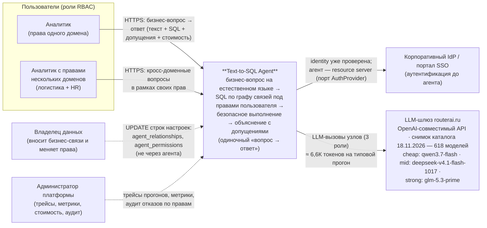

# C4 Level 1 — System Context

- **Статус:** каноническая схема v1.2 (2026-11-18 — синхронизация с ревью-03/D-017: снимок каталога 618 моделей, токены типового прогона 6,6К. v1.1 — граф: Neo4j вместо AGE; v1.0 — 2026-11-14)
- **Требования prd.md:** FR-1 (вопрос → ответ), FR-6 (RBAC: identity до агента), FR-8 (каскад моделей через один шлюз), §2 (роли пользователей)
- **Связанные:** ADR-002 (граница системы — state machine), ADR-003 (хранилище внутри контура), ADR-005 (аутентификация за портом AuthProvider), ADR-007 (LLM-шлюз)

## Чтение схемы

- **Роли различаются данными, не приложениями:** одно приложение (CLI / Streamlit-демо),
  scope прав определяет, какой мир видит пользователь (ADR-005: граница знаний =
  граница прав). Кросс-доменный аналитик — тот же интерфейс, шире подграф.
- **Владелец данных не общается с агентом.** Он правит настройки (связи — ADR-006,
  права — ADR-005) `UPDATE`-ом строк в БД; агент их только читает и никогда не меняет.
  Изменение действует со следующего запроса — без деплоя и DDL.
- **Аутентификация — вне системы, за портом `AuthProvider`:** агент получает уже
  проверенную личность (идентичность из подписанного токена); MVP — `DevTokenAuth`
  (выбор пользователя в демо — живое показ RBAC), production — `OIDCAuth`. Голый
  `user_id` параметром — не identity (ADR-005).
- **LLM-шлюз — единственный внешний сервисный вызов.** Смена модели — параметр
  вызова, не инфраструктура (ADR-007); три роли `cheap / mid / strong` зашиты в граф.
  Осознанный допуск: текст промптов (DDL разрешённых таблиц, вопрос) уходит к
  провайдеру; в production-контуре с требованиями локализации — локальные модели или
  LLMaaS в периметре (revisit ADR-007, правка BASE_URL без изменения архитектуры).
- **Хранилища внутри контура** (на этой схеме не раскрываются — уровень C4 L2):
  PostgreSQL (данные + pgvector + настройки), Neo4j (граф связей) и Valkey (кэш).
- **Наружу данные не экспортируются:** ответ содержит SQL и цифры, но система — не
  экспортный канал; отток данных возможен только через текст промптов к LLM (см. выше).

---

## Трассировка

Ревизии: v1.2 · Связанные ADR: ADR-002, ADR-003, ADR-005, ADR-006, ADR-007 · Канон: hw-01/README.md §1, §3
