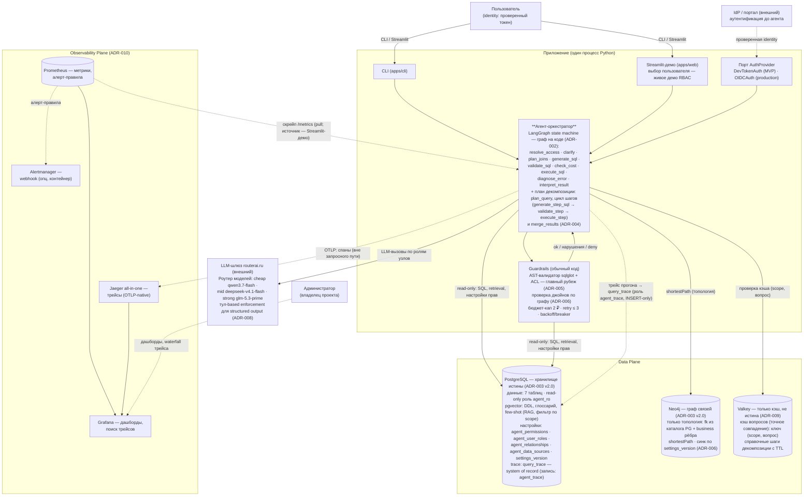

# C4 Level 2 — Container

- **Статус:** каноническая схема v1.7 (2026-11-15 — граф: Neo4j вместо AGE, ADR-003 v2.0; v1.6 — решения владельца FIX-005: кэш вопросов без семантической близости, источник `/metrics` — Streamlit-демо; v1.5 2026-11-14 — ревизия 02 + SAP-точка роста, ADR-011 v1.1) — включает развёртывание (отдельный deployment.md не нужен)
- **Требования prd.md:** FR-1…FR-14 (контур целиком), NFR-7 (смена провайдера конфигом)
- **Связанные:** ADR-002 (state machine), ADR-003 (хранилища: PG + Neo4j), ADR-005 (RBAC, AuthProvider), ADR-006 (синк топологии графа), ADR-007 (роутер моделей), ADR-008 (принудительные форматы), ADR-009 (кэш), ADR-010 (Observability Plane); code-architecture-draft.md (слои и порты); observability.md (сигналы наблюдаемости)

## Чтение схемы

- **Продуктовых деплой-единиц четыре** — развёртывание docker-compose: `app` (весь
  Control Plane: CLI/Streamlit + оркестратор + guardrails + порт авторизации),
  `db` (PostgreSQL + pgvector, официальный образ), `neo4j` (граф связей),
  `valkey`. Внешние:
  LLM-шлюз и IdP. Плюс плоскость телеметрии (ADR-010): jaeger, prometheus, grafana,
  alertmanager (опциональный контейнер) — та же внутренняя сеть, порты наружу
  не публикуются; экспорт телеметрии асинхронный, вне запросного пути, без
  коллектора (спаны — OTLP в Jaeger из любого процесса; метрики — `/metrics`
  долгоживущего Streamlit-демо под скрейпом Prometheus — CLI-прогон живёт секунды
  и не скрейбится, ADR-010 v1.2).
- **Оркестратор — единственный процесс агента.** Guardrails и порт AuthProvider —
  компоненты того же процесса (библиотеки за портами), не отдельные сервисы:
  масштаб уровня «учебный проект + пет-проект», не микросервисы.
- **Слои и порты** (code-architecture-draft): `domain` (сущности AgentState, JoinPlan,
  JoinEdge, QueryPlan, QueryStep) → `application` (сервисы узлов + порты `LLMProvider`,
  `VectorStore`, `GraphStore`, `SQLExecutor`, `SemanticCache`, `AuthProvider`, `Tracer`,
  `BudgetGuard`) → `infrastructure` (адаптеры: routerai-провайдер, pgvector, neo4j,
  sqlglot, Valkey, DevToken/OIDC) → `orchestration` (только рёбра графа LangGraph) →
  `composition` (DI-сборка). Правила импортов проверяются `import-linter`.
- **Роутер моделей — свойство провайдера:** `LLMProvider.complete(role, ...)` с тремя
  ролями `cheap / mid / strong`; узлы не знают конкретных моделей (ADR-007). Смена
  провайдера (routerai ↔ локальный Ollama) — переменная окружения, без правки узлов
  (NFR-7). Тулы принудительных форматов регистрируются в composition-слое (ADR-008).
- **Data Plane не публикует порты наружу** (docker-compose: только внутренняя сеть);
  приложение — единственный клиент `agent_ro` (read-only, timeout 30s, one-time
  hardening — ADR-005). Valkey — единственный компонент вне PostgreSQL, и он кэш:
  потеря содержимого — деградация скорости, не данных.
- **Потоки данных:** вопрос и права — внутрь state машины; наружу — только LLM-промпты
  (текст вопроса + DDL разрешённых таблиц) и запись трейса. Результаты SQL к LLM
  уходят только в `interpret_result` и всегда компактным сводом, собранным кодом:
  агрегаты результата (row_count, суммы/средние по числовым колонкам) и при
  «списочных» вопросах не более 20 строк; сырые строки сверх N к LLM не ходят
  никогда — ни на лёгком пути, ни после merge_results (ADR-004; ревизия 02 §3.5).
- **Наблюдаемость (observability.md, ADR-010):** трейс прогона — в `query_trace`
  (system of record: включая `node_timings`/`ttft_ms` по LLM-вызовам); live — спаны
  OTLP в Jaeger, метрики — скрейп `/metrics` (источник — Streamlit-демо)
  Prometheus'ом, дашборды и поиск
  трейсов — Grafana, уведомления — Alertmanager; логи — структурные JSON в stdout
  контейнера; алерт-правила — по симптомным сигналам (§4 observability.md).
- **Точки роста за портами** (не меняя схему): `VectorStore` → отдельная векторная БД
  при миллионах точек; `GraphStore` → Neo4j (перенос рёбер и Cypher один-в-один);
  `AuthProvider` → корпоративный SSO; `AccessPolicy` → внешний policy-движок (revisit
  ADR-005); `SQLExecutor` → внешний источник SAP (спека QuerySpec по HTTPS — ручка
  на ABAP строит Open SQL и проверяет права; ADR-011).

---

## Трассировка

Ревизии: v1.5 · Связанные ADR: ADR-002…011 · Канон: hw-01/README.md §3.2
