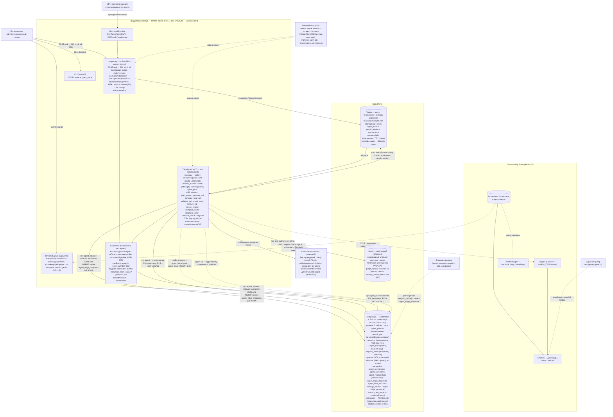

# C4 Level 2 — Container

- **Статус:** каноническая схема v1.9 (2026-11-21 — S09: пул agent_planner — +INSERT заявок agent_edge_proposals, миграция 0009, D-030; остальное — v1.8). v1.8 (2026-11-18 — развёртывание N1 (ревью-03, D-017 Python-native): асинхронный API — `agent-api` FastAPI/uvicorn (stateless Deployment + HPA; `POST /ask → 202 + job_id`, `GET /ask/{id}/stream` — SSE) и `agent-worker` arq (очередь — Valkey Streams; Deployment); PostgreSQL StatefulSet + PVC, миграции — Alembic Job; раздельные psycopg-пулы по ролям (`agent_planner`/`agent_ro`); NetworkPolicy — egress только к LLM-шлюзу; OTel-instrumentation fastapi/psycopg/httpx; аудит (S8) отдельно от трейсов; `asyncio.timeout(90)`; minikube — целевой dev-контур. v1.7 — Neo4j вместо AGE; v1.6 — решения владельца FIX-005 (кэш точного совпадения, источник `/metrics` — Streamlit-демо); v1.5 — ревизия 02 + SAP)
- **Требования prd.md:** FR-1…FR-14 (контур целиком), NFR-1 (p95/TTFT), NFR-7 (смена провайдера конфигом)
- **Связанные:** ADR-002 (state machine), ADR-003 (хранилища: PG + Neo4j), ADR-005 (RBAC, AuthProvider, рубеж БД), ADR-006 (реестр-SoT, синк снапшота графа), ADR-007 (роутер моделей), ADR-008 (принудительные форматы), ADR-009 (кэш), ADR-010 (Observability Plane); code-architecture-draft.md (слои и порты); observability.md (сигналы наблюдаемости); security.md §5 (сеть)

## Чтение схемы

- **Развёртывание — Python-native, k8s (N1, D-017; minikube — целевой dev-контур,
  compose остаётся для локальной отладки):**
  - **`agent-api` — FastAPI + uvicorn (async, stateless Deployment + HPA):**
    принимает `POST /ask` → `202 + job_id` (не блокирует соединение на долгий
    прогон), прогресс и результат — `GET /ask/{id}/stream` (SSE); на каждом хендлере
    `asyncio.timeout(90)` — дедлайн прогона enforced на границе API; stateless —
    сессии в checkpointer (Valkey), состояние прогона в checkpointer/state, горизонтальное
    масштабирование без sticky-сессий.
  - **`agent-worker` — arq (Deployment):** тяжёлые прогоны FSM-графа вне
    request-цикла; очередь — **Valkey Streams** (у Valkey они уже есть — отдельный
    брокер не добавляется); N воркеров → параллелизм прогонов, ретраи джобов —
    на уровне очереди, не модели.
  - **CLI/Streamlit** — точки входа дев-контура: CLI — OTLP-спаны + query_trace;
    Streamlit-демо — живое демо RBAC и источник `/metrics` (ADR-010 v1.2).
- **PostgreSQL — StatefulSet + PVC** (официальный образ pgvector/pgvector);
  **схема создаётся только миграциями Alembic** (`make infra-migrate`; Job/init-контур
  при деплое — D-009). **Раздельные psycopg-пулы по ролям:** планировщик
  (`agent_planner` — retrieval, настройки, `EXPLAIN`, INSERT заявок (S09), `search_path` со служебными
  схемами графа), исполнитель (`agent_ro` — read-only, RLS + `SET LOCAL
  app.user_id`, без служебных схем), трейс (`agent_trace`, INSERT-only), владелец
  реестра (`registry_writer` — запись рёбер только через ревью; агент read-only).
  Pooler в transaction-pooling-режиме — только `SET LOCAL` (security §2.1).
- **NetworkPolicy:** egress подов агента — только к LLM-шлюзу (плюс Data Plane и
  Observability Plane внутри кластера); ingress — через ingress-контроллер к
  `agent-api`; Data Plane наружу портов не публикует (security §5).
- **Guardrails и порт AuthProvider — библиотеки, не сервисы:** компоненты того же
  кода, что воркер/api (порты приложения); масштаб уровня «учебный проект +
  пет-проект», не микросервисы.
- **Слои и порты** (code-architecture-draft, AGENTS «Architecture Boundaries»):
  `composition` (DI-сборка) над двумя НЕЗАВИСИМЫМИ ногами — `orchestration`
  (только рёбра графа LangGraph) и `infrastructure` (адаптеры: routerai-провайдер,
  pgvector, neo4j, sqlglot, Valkey, DevToken/OIDC; единственный вместе с
  composition читает `config`) — обе внутрь: `application` (сервисы узлов + порты
  `LLMProvider`, `VectorStore`, `SchemaGraphStore`, `SQLExecutor`, `SemanticCache`,
  `AuthProvider`, `Tracer`, `BudgetGuard`; инфраструктура реализует только порты)
  → `domain` (сущности AgentState, JoinPlan, JoinEdge, QueryPlan, QueryStep,
  ResultCompact). Точки входа `apps` — над `composition`; `apps → {infrastructure,
  orchestration, config}` запрещены напрямую (приложение не импортирует адаптеры,
  граф и конфиг минуя composition). `orchestration` ↔
  `infrastructure` независимы (линейная цепочка «orchestration → infrastructure»
  из прежней формулировки — FIX-018). Правила импортов проверяются `import-linter`
  (`[tool.importlinter]` в pyproject.toml, 10 контрактов — S30).
- **Роутер моделей — свойство провайдера:** `LLMProvider.complete(role, ...)` с тремя
  ролями `cheap / mid / strong`; узлы не знают конкретных моделей (ADR-007). Смена
  провайдера (routerai ↔ локальный Ollama) — переменная окружения, без правки узлов
  (NFR-7). Тулы принудительных форматов регистрируются в composition-слое (ADR-008).
- **Data Plane не публикует порты наружу**; приложение — единственный клиент
  `agent_ro` (read-only, timeout 30s, one-time hardening — ADR-005). Valkey и Neo4j —
  вне PostgreSQL, оба — производные: потеря содержимого Valkey — деградация
  скорости; потеря Neo4j — деградация планирования («путь не найден»), данные и
  семантика — в PG (перестройка снапшота из реестра).
- **Потоки данных:** вопрос и права — внутрь state машины; наружу — только LLM-промпты
  (текст вопроса + DDL разрешённых таблиц) и запись трейса/аудита. Результаты SQL к
  LLM уходят только через `compact_result`: `row_count`, агрегаты, ≤ 20 строк и
  флаги усечения/`approximate`; сырые строки сверх N к LLM не ходят никогда — ни на
  лёгком пути, ни после `merge_results`. **Аудит (S8) — отдельная append-only
  таблица, отдельно от трейсов** (пользователь, вопрос, SQL, `edge_id`,
  `graph_version`, строки, отказы, стоимость, уровни моделей).
- **Наблюдаемость (observability.md, ADR-010):** OTel-instrumentation —
  **fastapi** (hendler-спаны), **psycopg** (SQL-спаны), **httpx** (LLM-вызовы);
  трейс прогона — в `query_trace` (system of record: включая `node_timings`/
  `ttft_ms`); live — спаны OTLP в Jaeger, метрики — скрейп `/metrics` (источник —
  Streamlit-демо) Prometheus'ом, дашборды и поиск трейсов — Grafana, уведомления —
  Alertmanager; логи — структурные JSON в stdout подов; алерт-правила — по
  симптомным сигналам (§4 observability.md).
- **Точки роста за портами** (не меняя схему): `VectorStore` → отдельная векторная БД
  при миллионах точек; `SchemaGraphStore` → альтернативное хранилище снапшота
  (BFS по adjacency — критерий переключения, D-015); `AuthProvider` → корпоративный
  SSO; `AccessPolicy` → внешний policy-движок (revisit ADR-005); `SQLExecutor` →
  внешний источник SAP (спека QuerySpec по HTTPS — ручка на ABAP строит Open SQL и
  проверяет права; ADR-011).

---

## Трассировка

Ревизии: v1.8 (развёртывание N1: agent-api/agent-worker, k8s, NetworkPolicy, OTel) · Связанные ADR: ADR-002…011 · Канон: hw-01/README.md §3.2 (развёртывание — N1 ревью-03)
