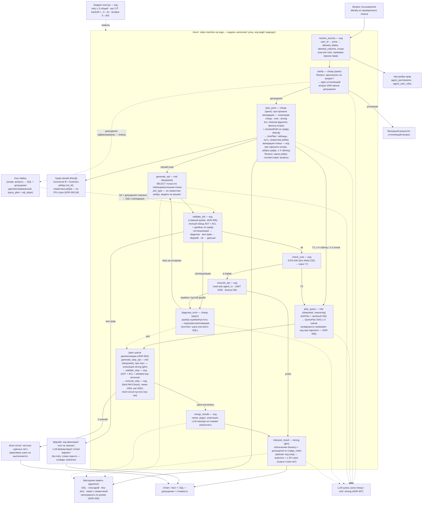

# C4 Level 3 — Component (внутреннее устройство агента)

- **Статус:** каноническая схема v1.3 (2026-11-16 — валидация JoinPlan + эскалация plan_joins, ADR-007 v1.1; v1.2 — граф: Neo4j вместо AGE; v1.1 — ревизия 02: позиция кэша, payload IR)
- **Требования prd.md:** FR-1…FR-11 (цикл, guardrails, RBAC, каскад), FR-12 (декомпозиция)
- **Связанные:** ADR-002 (карта «кто что решает»), ADR-004 (цикл шагов), ADR-005 (три рубежа), ADR-006 (семантика рёбер), ADR-007 (модель на узел), ADR-008 (структурированные выходы); state-agent.md (та же машина в state-нотации), sequence-query.md (сквозной путь тяжёлого запроса)

## Чтение схемы

- **ReAct-семантика внутри узлов:** каждый содержательный узел несёт Reason
  (вербализация перед действием — ~100 дешёвых токенов против повторного цикла при
  ошибочном вызове) и Observe (результат инструмента в state). Чисто кодовые узлы
  (`resolve_access`, `validate_sql`, `check_cost`, `execute_sql`, `merge_results`,
  `validate_step`, `execute_step`) — без LLM: граница прав и корректность не доверяются
  модели (ADR-002: детерминизм — безопасность, агентность — семантика).
- **Инструменты агента** (вызываемые узлами, с ограничениями): `plan_joins` (≤ 4 таблиц),
  `describe_table` (только таблицы из прав), `run_sql` (read-only, LIMIT 1000, timeout
  30s), `explain_sql` (только `EXPLAIN`; `EXPLAIN ANALYZE` запрещён — он выполняет
  запрос), `diagnose_error` (лимит 3 попыток). Инструменты — порты приложения; LLM
  не выбирает их сама — маршрут зашит в граф.
- **Кэш:** lookup — **после `clarify`, до `plan_joins`** (ADR-009 п. 6, ревизия 02
  §3.3): сверять допущения можно только когда они уже зафиксированы. Hit при
  совпадении допущений даёт короткий путь: одиночный SQL → `validate_sql` минуя
  генерацию; декомпозированный → цикл `validate_step → execute_step` минуя
  `plan_query`/`generate_step` (реплей `query_plan` + `sql_steps` из значения).
  Валидация кэшированного SQL не пропускается никогда (ключ со scope — ADR-005/009);
  на хите экономятся retrieval и shortestPath; `put` — оркестратор по факту
  успешного прогона.
- **Три рубежа прав на этой схеме:** (1) фильтрация мира — `plan_joins`/retrieval/DDL
  только по scope; (2) `validate_sql` — главный рубеж (полный обход AST + ACL +
  граф); (3) `execute_sql` — coarse (agent_ro). Различение исходов: не существует →
  `diagnose_error` (retry); вне прав → `degrade` без retry (ADR-005).
- **Два динамических механизма роутинга** без классификатора сложности: триггеры
  T1/T2 (детерминированные пороги, код) и эскалация — единое правило генерирующих
  узлов (ADR-007 v1.1): повторная попытка после провала идёт на уровень вверх
  (cheap→mid→strong; plan_joins — по провалу валидации JoinPlan кодом, SQL/шаги —
  после diagnose_error); эскалацию назначает код (`retry_count`), эскалации
  расходуют общий retry-бюджет ≤ 3.
- **Бюджет-контур — сквозной:** retry ≤ 3 общий (на весь план в декомпозиции), кап
  2 ₽ на запрос; guard проверяется до каждого LLM-вызова (плановая точка —
  `check_cost` → `budget_stop`, state-agent.md). Контракт остановки: неполное не
  выдаётся за полное — частичный результат только с `incomplete`-флагом, иначе отказ.
  Backoff/breaker на 429 — всё в коде, модель не переопределяет.
- **Трейс:** каждый узел и переход — спан; в `query_trace` ложатся вопрос, допущения,
  план, SQL шагов, retry_count, latency, стоимость, cache hit — основа eval-сета
  (FR-11).

---

## Трассировка

Ревизии: v1.3 (v1.3 — валидация JoinPlan + эскалация plan_joins; v1.2 — Neo4j; v1.1 — ревизия 02) · Связанные ADR: ADR-002, ADR-004, ADR-005, ADR-006, ADR-007, ADR-008, ADR-009 · Канон: hw-01/README.md §2–3
