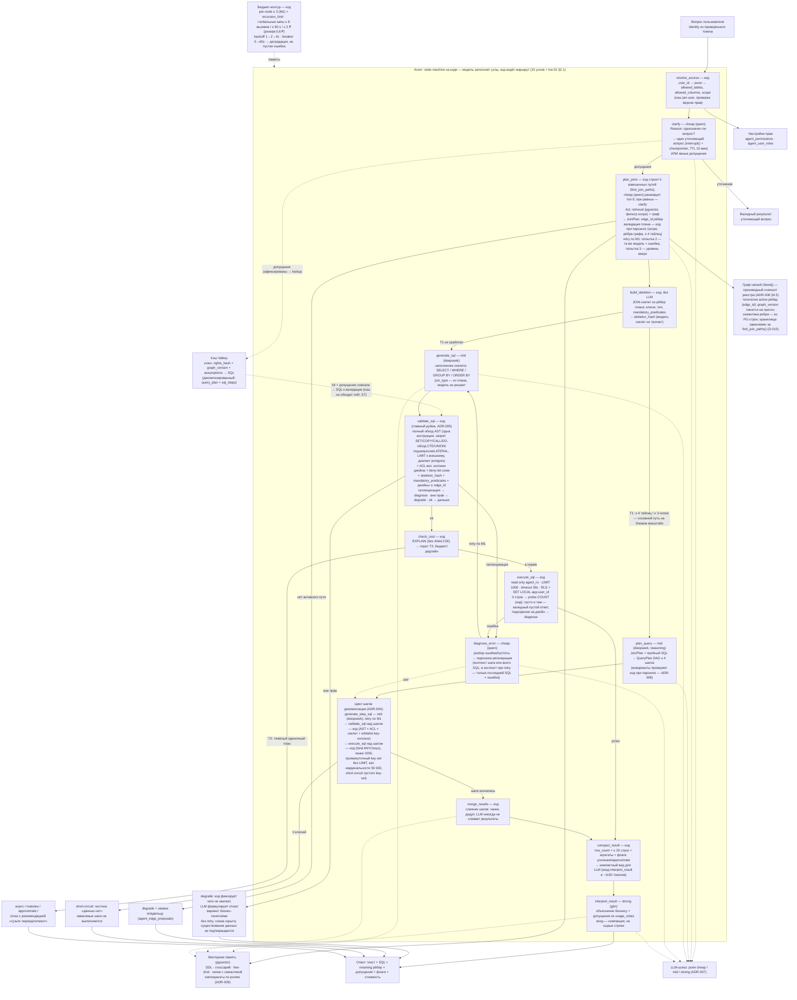

# C4 Level 3 — Component (внутреннее устройство агента)

- **Статус:** каноническая схема v1.5 (2026-11-18 — пост-приёмочный патч по отзыву преподавателя: Reason = краткий план следующего действия, трейс-минимум (решение + инструмент + результат). v1.4 — синхронизация с hw-01 §2.1/§3.1 (build_skeleton/compact_result/probe, k путей, M1); v1.3 — валидация JoinPlan; v1.2 — Neo4j; v1.1 — ревизия 02)
- **Требования prd.md:** FR-1…FR-11 (цикл, guardrails, RBAC, каскад), FR-12 (декомпозиция)
- **Связанные:** ADR-002 (карта «кто что решает», recursion_limit), ADR-004 (цикл шагов, T2-исходы), ADR-005 (рубежи 1–5), ADR-006 (реестр-SoT, `edge_id`), ADR-007 (модель на узел, политика M1), ADR-008 (структурированные выходы); state-agent.md (та же машина в state-нотации), sequence-query.md (сквозной путь тяжёлого запроса)

## Чтение схемы

- **Состав узлов — 15, идентичен state-agent.md и hw-01 §2.1:** `resolve_access`,
  `clarify`, `plan_joins`, `build_skeleton`, `plan_query`, `generate_sql`,
  `generate_step_sql`, `validate_sql`, `check_cost`, `execute_sql`,
  `merge_results`, `compact_result`, `diagnose_error`, `interpret_result`,
  `degrade`; probe `COUNT` — ребро `execute_sql`, T2-ветка `degraded_out`.
- **ReAct-семантика внутри узлов:** каждый содержательный узел несёт Reason
  (краткий план следующего действия — структурированное обоснование, ~100 дешёвых
  токенов против повторного цикла при ошибочном вызове; не свободная вербализация —
  в трейсе достаточно решения, вызванного инструмента и результата) и Observe
  (результат инструмента в state). Чисто кодовые узлы
  (`resolve_access`, `build_skeleton`, `validate_sql`, `check_cost`, `execute_sql`,
  `merge_results`, `compact_result`, `degrade` и валидация/исполнение шага) — без
  LLM: граница прав и корректность не доверяются модели (ADR-002: детерминизм —
  безопасность, агентность — семантика).
- **Path-поиск — k взвешенных путей, не shortestPath-правило:** реестр — мультиграф
  (несколько активных рёбер между парой таблиц с разной семантикой), поэтому код
  строит k взвешенных путей с фильтрацией по свойствам рёбер (`intent_tags`,
  `temporal`), модель ранжирует топ-5, при равных кандидатах — `clarify` (A6).
  `shortestPath` — имя функции Neo4j, не решающее правило планировщика.
- **Инструменты агента** (вызываемые узлами, с ограничениями): `search_schema` /
  `find_join_paths` (только активные рёбра реестра), `describe_table` (только
  таблицы из прав), `run_sql` (read-only, LIMIT 1000, timeout 30s), `explain_sql`
  (только `EXPLAIN`; `EXPLAIN ANALYZE` запрещён — он выполняет запрос). Инструменты —
  порты приложения; LLM не выбирает их сама — маршрут зашит в граф.
- **Кэш:** lookup — **после `clarify`, до `plan_joins`** (ADR-009 п. 6, ревизия 02
  §3.3): сверять допущения можно только когда они уже зафиксированы. Ключ —
  `rights_hash + graph_version + assumptions`, кэшируется SQL, не результат; hit не
  обходит гейт: SQL проходит `validate_sql` + ACL против текущих прав + `EXPLAIN`
  (S7). Hit при совпадении допущений даёт короткий путь: одиночный SQL →
  `validate_sql` минуя генерацию; декомпозированный → цикл `validate → execute`
  минуя `plan_query`/`generate_step_sql` (реплей `query_plan` + `sql_steps` из
  значения). `put` — оркестратор по факту успешного прогона.
- **Рубежи прав на этой схеме (ADR-005 v1.2):** (1) фильтрация мира —
  `plan_joins`/retrieval/DDL только по scope; (2) `validate_sql` — главный рубеж
  (полный обход AST, deny-list команд/функций, скелет, `mandatory_predicates`);
  (3) deny-list схем (`pg_catalog`, `information_schema`, служебные схемы графа,
  `agent_*`); (4) ACL колонок соединения — ключи джойна ∈ правам, иначе ребро
  недоступно целиком; (5) `execute_sql` — БД (agent_ro, RLS + `SET LOCAL
  app.user_id`, раздельные коннекты планировщик/исполнитель). Различение исходов:
  не существует → `diagnose_error` (retry); вне прав → `degrade` без retry (ADR-005).
- **Два динамических механизма роутинга** без классификатора сложности: триггеры
  T1/T2 (детерминированные пороги, код) и политика ретраев M1 (D-016, ADR-007 §4.1):
  попытка 1 — базовая модель узла; попытка 2 — та же модель + текст ошибки; попытка
  3 — уровень вверх при достатке бюджета (проверка с резервом 0,6 ₽). Эскалацию
  назначает код (`retry_count`); в контекст при retry — только последний SQL/план +
  текст ошибки.
- **Бюджет-контур — сквозной:** два уровня предохранителей (per-node ≤ 3 +
  `recursion_limit` — ADR-002) и глобальные капы (≤ 8 вызовов / ≤ 90 s / ≤ 2 ₽);
  guard проверяется до каждого LLM-вызова и перед каждой эскалацией (плановая точка
  — `check_cost` → `budget_stop`, state-agent.md). Контракт остановки: неполное не
  выдаётся за полное — частичный результат только с `incomplete`-флагом, иначе
  отказ. Backoff/breaker на 429 — всё в коде; breaker завершается деградацией
  (валидный SQL без объяснения / отложенная задача), не пустой ошибкой.
- **Трейс:** каждый узел и переход — спан; в `query_trace` ложатся вопрос, допущения,
  план, `edge_id`, `graph_version`, SQL шагов, retry_count, latency, стоимость,
  cache hit — основа eval-сета (FR-11); аудит append-only (S8) — отдельно от трейсов.

---

## Трассировка

Ревизии: v1.5 (Reason = краткий план, трейс-минимум) · Связанные ADR: ADR-002, ADR-004, ADR-005, ADR-006, ADR-007, ADR-008, ADR-009 · Канон: hw-01/README.md §2–3
