# ER Diagram — модель данных

- **Статус:** каноническая схема v1.4 (2026-11-15 — граф: Neo4j вместо AGE, ADR-003 v2.0; v1.3 — +`agent_data_sources` вслед за ADR-011 v1.7; v1.2 2026-11-14 — ревизия 02: канал `agent_trace`, счётчики `settings_version`)
- **Требования prd.md:** FR-2 (граф связей), FR-6 (RBAC как настройки), FR-7 (семантика связей), FR-11 (трейс)
- **Связанные:** ADR-003 (всё в одном PostgreSQL), ADR-005 (права как данные), ADR-006 (связи как данные), ADR-009 (кэш — вне этой схемы, Valkey), ADR-011 (agent_data_sources — каталог источников)

```mermaid
erDiagram
    CUSTOMERS ||--o{ ORDERS : "places"
    CAMPAIGNS ||--o{ ORDERS : "attributes (fk, first-touch)"
    ORDERS ||--o{ ORDER_ITEMS : "contains"
    PRODUCTS ||--o{ ORDER_ITEMS : "sold as"
    EMPLOYEES ||--o{ BONUSES : "receives (left join!)"
    AGENT_USER_ROLES }o..o{ AGENT_PERMISSIONS : "role (text, без FK)"
    AGENT_USER_ROLES }o..o{ AGENT_RELATIONSHIPS : "владелец вносит рёбра"

    CUSTOMERS {
        int customer_id PK
        string name "при реальных данных — персональные данные (синтетика v1)"
        string country "критерий «новый клиент» — по created_at"
        timestamp created_at
    }
    CAMPAIGNS {
        int campaign_id PK
        string name
        string channel "ads | email | partner"
        date started_at
    }
    ORDERS {
        int order_id PK
        int customer_id FK
        int campaign_id FK "NULL — заказ вне кампаний: любой inner джойн отфильтрует"
        date order_date
        string status "paid | shipped | cancelled"
        numeric total
    }
    ORDER_ITEMS {
        int order_item_id PK
        int order_id FK
        int product_id FK
        int quantity
        numeric unit_price
    }
    PRODUCTS {
        int product_id PK
        string name
        string category
        numeric price
    }
    EMPLOYEES {
        int employee_id PK
        string name "при реальных данных — персональные данные (синтетика v1)"
        string department "sales | logistics | hr"
        numeric salary "PII-колонка: по умолчанию вне прав, кроме hr; метка mask — PII_MASK_COLUMNS (security §3)"
    }
    BONUSES {
        int bonus_id PK
        int employee_id FK
        string period "2026-Q4"
        numeric amount
    }
    AGENT_PERMISSIONS {
        string role "логистика_viewer | hr_viewer | ..."
        string schema_name "default public"
        string table_name
        string columns "'*' | 'employee_id,name,department'"
        string updated_by
        timestamp updated_at "версия прав для инвалидации кэша"
    }
    AGENT_USER_ROLES {
        string user_id "identity из IdP, text без FK"
        string role
    }
    AGENT_RELATIONSHIPS {
        int rel_id PK
        string left_table
        string left_column
        string right_table
        string right_column
        string kind "fk | business"
        string meaning "заказ атрибутирован кампании"
        string join_type "бизнес-дефолт: inner | left"
        string usage_notes "ловушки: first-touch, campaign_id надёжен с 2026-03"
        string created_by
        timestamp created_at
    }
    SETTINGS_VERSION {
        string name PK "'permissions' | 'user_roles' | 'relationships'"
        bigint version "инкремент триггером на INSERT/UPDATE/DELETE строк настроек"
    }
    AGENT_DATA_SOURCES {
        string table_name PK "таблица → источник (ADR-011)"
        string ds_id "'pg' | 'sap'"
        string protocol "sql | spec — форма запроса к источнику"
    }
    QUERY_TRACE {
        uuid trace_id PK
        string user_id "проверенная identity"
        string question
        jsonb assumptions "допущения clarify"
        jsonb join_plan
        jsonb query_plan "NULL без декомпозиции"
        text sql "SQL (шаги — массивом в sql_steps)"
        int retry_count
        int latency_ms
        int ttft_ms "TTFT первого LLM-вызова — NFR-1, R-C2"
        numeric cost_rub
        jsonb node_timings "события LLM-вызовов — node/role/model/attempt/ttft_ms/latency_ms/tokens/cost_rub/cache_hit/timeout"
        bool cache_hit
        bool incomplete "true — результат неполный (budget_stop): interpret не выдал его за полный"
        string status "ok | clarification | degrade | fail | overflow | short_circuit | rejected | budget_stop"
        timestamp created_at
    }
```

## Чтение схемы

- **Бизнес-схема (7 таблиц):** классическая витрина заказов + HR-домен
  (`employees`, `bonuses`) — HR добавлен сознательно, чтобы сцены RBAC (допуск /
  deny / деградация) и семантики (`LEFT JOIN ... IS NULL` для «не был премирован»)
  были не синтетикой. Полезная ловушка в данных: `orders.campaign_id` NULLABLE —
  заказы вне кампаний молча теряются в INNER JOIN, что делает `join_type` ребра
  содержательным решением, а не деталью синтаксиса (ADR-006).
- **Таблицы настроек — данные, не конфиг** (ADR-005/006): `agent_permissions`,
  `agent_user_roles`, `agent_relationships` редактируются владельцами `UPDATE`-ом
  строк; агент только читает. Роль — text-значение, не FK-сущность: добавление роли
  не требует миграции. Версия каждой группы настроек — триггерный счётчик
  `settings_version` (ADR-005 §4, ревизия 02 §3.2): инкремент на
  INSERT/UPDATE/DELETE — покрывает revoke роли и удаление строки/ребра, чего
  `max(updated_at)` не ловил; по счётчику сбрасываются per-user кэш прав
  (`resolve_access`) и кэш Valkey (ADR-009, п. 5).
- **`agent_data_sources` (v1.3):** каталог источников (ADR-011) — таблица → `ds_id` +
  `protocol` (`sql` — PG-путь: текст + sqlglot; `spec` — QuerySpec для внешних ручек);
  источник вычисляет код, LLM о нём не знает. В v1 одна строка `pg/sql`; таблицу создаёт
  первая миграция (feat-002), SAP добавляется после ДЗ-06 без правки схемы.
- **`columns` семантика:** `'*'` — все колонки; список — только перечисленные
  (`employees.salary` по умолчанию недоступен никому, кроме `hr_viewer`).
- **`agent_relationships`:** FK-рёбра вычитываются из системного каталога
  автоматически (топология дублируется в граф Neo4j с `rel_id`; семантика при
  планировании читается из этих строк — протокол ADR-006 §4); бизнес-рёбра (по дате,
  по email, иерархии) — вносятся владельцем. `join_type` — бизнес-дефолт типа джойна;
  `usage_notes` — обязательные допущения, которые `interpret_result` обязан
  раскрывать. UNIQUE на четвёрке колонок — одно ребро на пару колонок.
- **`status` — полная коллекция терминалов FSM** (state-agent.md): `rejected`
  (identity fail-closed) и `budget_stop` (кап 2 ₽) — аудит-значимые исходы наравне с
  остальными; `incomplete = true` сопровождает частичный результат `budget_stop` —
  по нему eval-сет отсеивает неполные ответы из эталонов.
- **`query_trace` — observational-таблица** (FR-11): append-only трейс каждого
  прогона — основа eval-сета («вопрос → эталонный SQL / путь / ребро»), калибровки
  T1/T2 и будущего динамического роутера (revisit ADR-007). `user_id` — text из
  identity, без FK: пользователь — не сущность нашей БД (аутентификация вне агента).
  Сюда же — `sql_steps` для декомпозиции (в jsonb `query_plan`/`sql`). `node_timings`
  — по-узловые события LLM-вызовов: экономика по узлам для пересчёта §7 ADR-007,
  индикаторы R-C2/R-C4; `ttft_ms` — TTFT первого вызова (NFR-1). Сигналы и пороги —
  observability.md. Append-only обеспечен физически: пишет отдельная роль
  `agent_trace` — единственный грант INSERT, SELECT/UPDATE/DELETE не выдаются
  (security §2.2; ревизия 02 §3.1).
- **Чего в схеме нет сознательно:** таблицы пользователей/сессий (история диалога —
  не-цель v1), таблицы кэша (Valkey — не истина, ADR-003), per-user GRANT-ов в
  PostgreSQL (права живут здесь, в настройках — ADR-005).

---

## Трассировка

Ревизии: v1.3 · Связанные ADR: ADR-003, ADR-005, ADR-006, ADR-007, ADR-009, ADR-011 · Канон: hw-01/README.md §3.4–3.5
