# ER Diagram — модель данных

- **Статус:** каноническая схема v1.9 (2026-11-21 — S09 feat-009: runtime-запись заявок — `agent_planner` получил INSERT на `agent_edge_proposals` + USAGE на sequence (миграция 0009, ruling Q1 ARCH-GATE S09, D-030); append-only — UPDATE/DELETE/SELECT не выданы, приватность «чужих вопросов» из 0002 не задета). v1.8 (2026-11-21 — S07 feat-007: ревизия v2 демо-ребра `e_campaigns_orders` — допущение first-touch в `usage_notes`, миграция 008, data-правка реестра без смены DDL). v1.7 (2026-11-20 — S06 fix-волна ревью: `referenced_tables` — права по всем таблицам документа, миграция 006, guard индексатора; кросс-табличные доки скрыты целиком). v1.6 (2026-11-20 — S06 feat-006: +`agent_knowledge` — векторная память знаний, dense-only (D-026 доп. 2), retrieval под ролью `agent_planner` (ruling W1 ARCH-GATE S06, c4-l2 v1.8), запись — только офлайн-индексация под сервисным DSN). v1.5 (2026-11-18 — синхронизация с ревью-03 R1/S8/N3: полный DDL-контракт ребра `agent_relationships` (единственный источник для миграций — ADR-006 §4.1); +`agent_edge_proposals` (заявки владельцу); `graph_version` в трейсе; +`agent_audit` (поля S8, append-only, отдельно от трейсов); pydantic-контракты `JoinPlan`/`QueryPlan`/`ResultCompact` и состав `AgentState` (N3). v1.4 — Neo4j вместо AGE; v1.3 — +`agent_data_sources`; v1.2 — канал `agent_trace`, счётчики `settings_version`)
- **Требования prd.md:** FR-2 (граф связей), FR-6 (RBAC как настройки), FR-7 (семантика связей), FR-11 (трейс + аудит)
- **Связанные:** ADR-003 (PG — истина, граф — снапшот), ADR-004 (декомпозиция), ADR-005 (права как данные), ADR-006 (реестр — единственный SoT, DDL §4.1), ADR-009 (кэш — вне этой схемы, Valkey), ADR-011 (agent_data_sources — каталог источников)

```mermaid
erDiagram
    CUSTOMERS ||--o{ ORDERS : "places"
    CAMPAIGNS ||--o{ ORDERS : "attributes (fk, first-touch)"
    ORDERS ||--o{ ORDER_ITEMS : "contains"
    PRODUCTS ||--o{ ORDER_ITEMS : "sold as"
    EMPLOYEES ||--o{ BONUSES : "receives (left join!)"
    AGENT_USER_ROLES }o..o{ AGENT_PERMISSIONS : "role (text, без FK)"
    AGENT_RELATIONSHIPS ||--o{ AGENT_RELATIONSHIPS : "replaced_by (устаревание вместо удаления)"

    CUSTOMERS {
        int customer_id PK
        string name "при реальных данных — персональные данные (синтетика v1)"
        string country "критерий «новый клиент» — по created_at"
        timestamp created_at
    }
    CAMPAIGNS {
        int campaign_id PK
        string name
        string channel "ads | email | partner"
        date started_at
    }
    ORDERS {
        int order_id PK
        int customer_id FK
        int campaign_id FK "NULL — заказ вне кампаний: любой inner джойн отфильтрует"
        date order_date
        string status "paid | shipped | cancelled"
        numeric total
    }
    ORDER_ITEMS {
        int order_item_id PK
        int order_id FK
        int product_id FK
        int quantity
        numeric unit_price
    }
    PRODUCTS {
        int product_id PK
        string name
        string category
        numeric price
    }
    EMPLOYEES {
        int employee_id PK
        string name "при реальных данных — персональные данные (синтетика v1)"
        string department "sales | logistics | hr"
        numeric salary "PII-колонка: по умолчанию вне прав, кроме hr; метка mask — PII_MASK_COLUMNS (security §3)"
    }
    BONUSES {
        int bonus_id PK
        int employee_id FK
        string period "2026-Q4"
        numeric amount
    }
    AGENT_PERMISSIONS {
        string role "логистика_viewer | hr_viewer | ..."
        string schema_name "default public"
        string table_name
        string columns "'*' | 'employee_id,name,department'"
        string updated_by
        timestamp updated_at "версия прав для инвалидации кэша"
    }
    AGENT_USER_ROLES {
        string user_id "identity из IdP, text без FK"
        string role
    }
    AGENT_RELATIONSHIPS {
        string edge_id PK "адресация в плане, валидаторе и аудите (R1)"
        int version "ревизия ребра: правка = +1"
        string status "draft | active | deprecated; агент читает только active (вьюха)"
        string replaced_by "FK → edge_id: устаревание вместо удаления"
        string left_table
        string left_columns "text[] — составные ключи"
        string right_table
        string right_columns "text[]"
        string join_operator "default '='"
        string join_type "inner | left — бизнес-дефолт, модель не решает"
        string cardinality "1:1 | 1:n | n:1 | n:m"
        bool fanout_guard "true — агрегация поверх ребра только с предагрегацией в CTE (ADR-004)"
        jsonb mandatory_predicates "MANDT, языковой ключ, deleted=false, tenant"
        jsonb temporal "«на дату заказа» vs «на сегодня»"
        string meaning "что связь значит бизнесу"
        string intent_tags "text[] — выбор между параллельными рёбрами"
        string usage_notes "ловушки; входят в ответ как допущения"
        numeric weight "ранжирование путей (k путей → топ-5)"
        string domain "доменная нарезка"
        string owner "ответственность"
        timestamp reviewed_at "последнее ревью владельцем"
        jsonb ci_report "протокол CI-гейта активации (ADR-006 §4.2)"
        timestamp created_at
    }
    AGENT_EDGE_PROPOSALS {
        int proposal_id PK
        string left_table
        string right_table
        string question_sample "пример вопроса без активного пути"
        int hits "частота — ранжирует очередь владельцу"
        string status "open | accepted | rejected"
        timestamp created_at
    }
    SETTINGS_VERSION {
        string name PK "'permissions' | 'user_roles' | 'relationships'"
        bigint version "инкремент триггером на INSERT/UPDATE/DELETE строк настроек; graph_version снапшота графа — производная этой ревизии (ADR-006 §4.3)"
    }
    AGENT_DATA_SOURCES {
        string table_name PK "таблица → источник (ADR-011)"
        string ds_id "'pg' | 'sap'"
        string protocol "sql | spec — форма запроса к источнику"
    }
    QUERY_TRACE {
        uuid trace_id PK
        string user_id "проверенная identity"
        string question
        jsonb assumptions "допущения clarify"
        jsonb join_plan "edge_id рёбер плана"
        string graph_version "пин снапшота реестра на прогон (state, кэш, аудит)"
        jsonb query_plan "NULL без декомпозиции"
        text sql "SQL (шаги — массивом в sql_steps)"
        int retry_count
        int latency_ms
        int ttft_ms "TTFT первого LLM-вызова — NFR-1, R-C2"
        numeric cost_rub
        jsonb node_timings "события LLM-вызовов — node/role/model/attempt/ttft_ms/latency_ms/tokens/cost_rub/cache_hit/timeout"
        bool cache_hit
        bool truncated "row_count = 1000 — флаг усечения в ответе"
        bool approximate "кап кардинальности 50 000 — результат приближённый"
        bool incomplete "true — результат неполный (budget_stop): interpret не выдал его за полный"
        string status "ok | clarification | degrade | fail | overflow | short_circuit | rejected | budget_stop | degraded_out"
        timestamp created_at
    }
    AGENT_AUDIT {
        bigint audit_id PK "поля S8 — append-only, отдельно от query_trace"
        string user_id
        string question
        text sql
        string edge_ids "рёбра плана"
        string graph_version "снапшот, по которому считали"
        int row_count
        jsonb refusals "отказы по правам (что именно, без чужой схемы)"
        numeric cost_rub
        jsonb model_levels "уровни моделей по вызовам"
        timestamp created_at "пишет отдельная INSERT-only роль; UPDATE/DELETE не выдаются"
    }
    AGENT_KNOWLEDGE {
        int id PK
        string doc_kind "ddl | relationship | glossary | few_shot — ровно 4 типа (ADR-003 §4)"
        string table_name "якорь-таблица (NULL = общий документ); сам фильтр прав — по referenced_tables"
        string[] referenced_tables "таблицы, упомянутые в документе: права проверяются по ВСЕМ (NFR-4 ACL-leak=0, ревью S06 C1); '{}' = общий документ"
        text content "чанк с префиксом-заголовком («[таблица: orders] …»)"
        vector embedding "vector(1024) — bge-m3; смена эмбеддера = переиндексация"
        string model_version "каким эмбеддером построен вектор (model-card)"
        string source_ref "UNIQUE — ключ идемпотентного upsert (файл:идентификатор)"
        timestamp created_at
        timestamp updated_at "ON CONFLICT (source_ref) DO UPDATE"
    }
```

## Контракты состояния и pydantic-модели (N3)

Структурированные выходы LLM — pydantic-модели (ADR-007/008, temperature 0); всё
остальное в state — данные, которыми управляет только код:

- **`JoinPlan`**: `edges[]` (каждое — `edge_id`, стороны с колонками, `join_type`,
  `mandatory_predicates`), `tables[]`, `intent`, `candidates_ranked` (топ-5 с
  весами). Валидируется кодом при парсинге: таблицы ∈ scope, джойны ∈ активным
  `edge_id`, ≤ 4 таблиц, связность.
- **`QueryPlan`**: `steps[]` (каждый — `purpose`, таблицы, `key_column` (whitelist),
  шаблон SQL), инварианты ≤ 4 шагов / ≤ 3 таблиц / ацикличность / топологический
  порядок.
- **`ResultCompact`**: `row_count`, `sample` (≤ 20 строк), `aggregates` (по числовым
  колонкам), `truncated`, `approximate`.
- **`AgentState`** (состав, N3): `question`, `identity`/`scope`
  (allowed_tables/columns), **`graph_version`** (пин на прогон), `assumptions` /
  `clarification`, `join_plan`, `skeleton` + `skeleton_hash` (JOIN-скелет от кода),
  `query_plan`, `step_results`, `current_step`, `rows`/`row_count`, `compact`
  (ResultCompact), `diagnosis`, `retry_count` (по узлам), `route_flags`,
  `cost_accum` / дедлайны (`deadline 90 s`, `statement_timeout 30 s`,
  `max_sql_executions 4`), `flags` (`truncated`, `approximate`, `incomplete`),
  `final_answer`. Аудит (S8) и трейс пишутся **вне** state — агент не может их
  дописать или скрыть.

## Чтение схемы

- **Бизнес-схема (7 таблиц):** классическая витрина заказов + HR-домен
  (`employees`, `bonuses`) — HR добавлен сознательно, чтобы сцены RBAC (допуск /
  deny / деградация) и семантики (`LEFT JOIN ... IS NULL` для «не был премирован»)
  были не синтетикой. Полезная ловушка в данных: `orders.campaign_id` NULLABLE —
  заказы вне кампаний молча теряются в INNER JOIN, что делает `join_type` ребра
  содержательным решением, а не деталью синтаксиса (ADR-006). Ревизия v2 ребра
  `e_campaigns_orders` (миграция 008, S07): `usage_notes` дополняется допущением
  атрибуции — «пришли из рекламы» = first-touch, any-touch завышает цифру
  (ADR-006 §4.7); `path_semantics` (S07) выводит его в ответы как допущение.
- **Таблицы настроек — данные, не конфиг** (ADR-005/006): `agent_permissions`,
  `agent_user_roles`, `agent_relationships` редактируются владельцами (реестр —
  только через ревью, роль `registry_writer`); агент только читает. Роль —
  text-значение, не FK-сущность: добавление роли не требует миграции. Версия каждой
  группы настроек — триггерный счётчик `settings_version` (ADR-005 §4): инкремент на
  INSERT/UPDATE/DELETE — покрывает revoke роли и устаревание ребра; **`graph_version`
  снапшота графа — производная ревизии реестра** (не дубль `settings_version`):
  триггер будит синк, снапшот получает новую ревизию, она пинится на прогон (state,
  ключ кэша, аудит); reconciliation-тест в CI — ADR-006 §4.3.
- **`agent_relationships` — контракт ребра R1 (DDL — ADR-006 §4.1, единственный
  источник для миграций):** реестр — **единственный SoT**; FK — генератор кандидатов
  в очередь владельцу, не ребро. Жизненный цикл `draft → CI → active` (CI по факту:
  колонки/типы/уникальность/сироты/измеренный fan-out против `cardinality`); агент
  читает только `active`-вьюху; `deprecated` + `replaced_by` вместо DELETE;
  `mandatory_predicates` (`MANDT`, `lang`, `deleted=false`, tenant) — обязательные
  предикаты скелета; `weight` + `intent_tags` — ранжирование k путей; запись —
  только владелец через ревью, изменения — в аудит.
- **`agent_edge_proposals`:** «нет активного пути» — не только отказ: заявка
  владельцу (пара сущностей, пример вопроса, частота `hits`); подтвердит — следующий
  такой вопрос уже отвечается (ADR-006 §4.4). Runtime-запись (S09, миграция 0009):
  `agent_planner` — INSERT-only (UPDATE/DELETE/SELECT не выданы — append-only через
  гранты, приватность «question_sample — чужие вопросы» из 0002 не задета); `hits`
  агент не инкрементит — частота = COUNT(*) строк для владельца (ruling Q1, D-030).
- **`agent_data_sources` (v1.3):** каталог источников (ADR-011) — таблица → `ds_id` +
  `protocol` (`sql` — PG-путь: текст + sqlglot; `spec` — QuerySpec для внешних ручек);
источник вычисляет код, LLM о нём не знает. В v1 — 7 строк `pg/sql` (по строке на бизнес-таблицу); таблицу создаёт
первая миграция (feat-002), SAP добавляется после ДЗ-06 без правки схемы.
- **`columns` семантика:** `'*'` — все колонки; список — только перечисленные
  (`employees.salary` по умолчанию недоступен никому, кроме `hr_viewer`).
- **`status` — полная коллекция терминалов FSM** (state-agent.md): `rejected`
  (identity fail-closed), `budget_stop` (кап 2 ₽) и `degraded_out` (T2-исход) —
  аудит-значимые исходы наравне с остальными; `incomplete = true` сопровождает
  частичный результат `budget_stop`, `truncated`/`approximate` — усечение и
  приближение, которые не выдаются за полное (eval-сет отсеивает такие из эталонов).
- **`query_trace` — observational-таблица** (FR-11): append-only трейс каждого
  прогона — основа eval-сета («вопрос → эталонный SQL / путь / ребро»), калибровки
  T1/T2 и будущего динамического роутера (revisit ADR-007). `graph_version` — с каким
  снапшотом реестра считали (иначе кэш/воспроизводимость не разобрать). `user_id` —
  text из identity, без FK: пользователь — не сущность нашей БД (аутентификация вне
  агента). `node_timings` — по-узловые события LLM-вызовов: экономика по узлам для
  пересчёта §4.3 ADR-007, индикаторы R-C2/R-C4. Append-only обеспечен физически:
  пишет отдельная роль `agent_trace` — единственный грант INSERT (security §2.2).
- **`agent_audit` — поля S8, append-only, отдельно от трейсов:** пользователь,
  вопрос, SQL, `edge_id` рёбер, `graph_version`, число строк, отказы по правам,
  стоимость, уровни моделей. Пишется вне state агента (не допишет и не скроет);
  PII в логах и трейсах редактируется (security §5).
- **`agent_knowledge` (v1.6, S06) — векторная память знаний** (feat-006, ADR-003 §4):
  4 кураторских типа документов (DDL, связи с семантикой, глоссарий, few-shot);
  автонаполнение запрещено. Поиск dense-only, HNSW по cosine (D-026 доп. 2;
  гибрид — V3, BL-007). **Фильтр прав — джойн в SQL поиска по ВСЕМ таблицам
  документа** (`referenced_tables`, миграции 006+007 — инвариант ревью S06 Critical-1:
  кросс-табличный few-shot «orders+campaigns» скрыт от пользователя без прав на
  campaigns; ADR-005 «граница знаний = граница прав», NFR-4 ACL-leak = 0);
  `'{}'` — общий документ. Каналы (ruling W1 ARCH-GATE S06): чтение — роль
  `agent_planner` (гранты 0002/0005), запись — только офлайн-индексация под
  сервисным DSN (`make index-knowledge` — флаг knowledge_writer контейнера,
  ревью S06 I2), идемпотентно по `source_ref`; индексатор заполняет список и
  guard-ом запрещает контент с необъявленными таблицами.
- **Чего в схеме нет сознательно:** таблицы пользователей/сессий (история диалога —
  не-цель v1), таблицы кэша (Valkey — не истина, ADR-003), per-user GRANT-ов в
  PostgreSQL (права живут здесь, в настройках — ADR-005).

---

## Трассировка

Ревизии: v1.9 (S09: agent_planner — INSERT-only на agent_edge_proposals, миграция 0009, ruling Q1/D-030) · v1.8 (S07: ревизия v2 демо-ребра e_campaigns_orders — first-touch в usage_notes, миграция 008) · v1.7 (S06 fix-волна: referenced_tables — инвариант прав по всем таблицам, миграции 006+007 — content-based backfill 0007 закрывает окно апгрейда) · v1.6 (S06: agent_knowledge — векторная память, dense-only, ruling W1) · v1.5 (контракт ребра R1, agent_edge_proposals, graph_version, аудит S8, pydantic N3) · Связанные ADR: ADR-003, ADR-004, ADR-005, ADR-006, ADR-007, ADR-009, ADR-011 · Канон: hw-01/README.md §3.3, §3.5
