# State Diagram — агент Text-to-SQL (FSM)

- **Статус:** каноническая схема v1.8 (2026-11-22 — ruling R3 ARCH-GATE S14/BL-016: ребро `generate_sql → generate_sql` (гейт retry_generate_sql) — generation-fail на FSM-ретрай-визите (битый выход модели) при незатраченном fuse → визит 3 — эскалация strong с бюджет-проверкой в сервисе; детур через diagnose_error отвергнут — битый выход генератора самодиагностируем; определение «попытки узла» — ruling R6, раздел «Ретраи»; подключение execute_sql + probe COUNT (код визита, не узел) и diagnose_error — feat-014). v1.7 — ruling R2 ARCH-GATE S10: два ребра отказа генерирующей цепочки — `plan_joins → degrade` («нет активного пути» + заявка владельцу — behavior feat-009, hw-01 §3.1; в v1.6 не рисовалось, диаграмма против канона) и `generate_sql → degrade` (исчерпание M1/бюджет/дефект скелета — носитель отказа генератора — degrade, state-agent: «лимит попыток / бюджет / дедлайн»; терминал `fail` исходит только из plan_joins); подключение plan_joins/build_skeleton/generate_sql — feat-010. **Механика M1 на петлях** (ревью S10 I7): попытки 1–2/3 исполняются ВНУТРИ узлов-сервисов (plan_joins/generate_sql — ruling R7 S10, счётчик не расходует FSM-рёбра); FSM-петли `retry_*` — каркас ретраев ВАЛИДАТОРА и ИСПОЛНЕНИЯ (validate_sql → diagnose_error → generate_sql — S11, execute_sql — S14): реальный узел plan_joins флаг `plan_joins_invalid` не пишет. v1.6 — FIX-009/ruling R1 ARCH-GATE S08: ребро `plan_joins → clarify` (равные кандидаты пути — hw-01 §4.2; в v1.5 ребро не рисовалось, канон-текст против диаграммы); clarify-механика interrupt: само-ребро `clarify → clarify` (вопрос сформулирован → пауза), `clarify → clarification` — отказ при несформулированном вопросе, TTL-истёк — clarification исходом от раннера. v1.5 — FIX-008: входящие рёбра overflow/short_circuit, цикл merge_results → generate_step_sql; v1.4 — 2026-11-18: ретрай шага декомпозиции — явное ребро `diagnose_error → generate_step_sql` (ретраится упавший шаг, не весь план); T2: approximate/matview — через `compact_result → interpret_result` с флагом `approximate`, async/отказ — терминал. v1.3 — состав 15 узлов = hw-01 §2.1, M1, recursion_limit, T2 → degraded_out; v1.2 — валидация JoinPlan; v1.1 — ревизия 02)
- **Требования prd.md:** FR-1…FR-14; переходы контролирует код — модель не может перепрыгнуть валидацию или уйти из цикла (ADR-002)
- **Связанные:** ADR-002 (recursion_limit — второй предохранитель), ADR-004 (ветка декомпозиции, T2-исходы), ADR-005 (degrade vs diagnose), ADR-006 (JoinPlan по `edge_id`), ADR-007 (политика ретраев M1), ADR-009 (кэш); c4-l3-agent.md (компоненты узлов), sequence-query.md (интерактивный путь целиком)

```mermaid
stateDiagram-v2
    [*] --> resolve_access: вопрос + identity из проверенного токена
    resolve_access --> clarify: права + graph_version в state (scope)
    resolve_access --> rejected: identity не проверена — fail-closed

    clarify --> clarify: неоднозначный вердикт (qwen/cheap) → РОВНО ОДИН уточняющий вопрос → interrupt() (сессия в checkpointer, TTL 10 мин); ответ пользователя резюмирует тот же прогон
    clarify --> clarification: вопрос сформулировать не удалось (сбой классификации) — честный отказ (S00-8)
    clarification --> [*]: валидный результат (TTL сессии истёк — тот же исход синтезирует раннер, ruling R3 S08)
    clarify --> plan_joins: допущения зафиксированы (вердикт классификатора + ответ пользователя)

    plan_joins --> clarify: равные кандидаты пути → уточняющий вопрос (ребро FIX-009; активирует S10)
    plan_joins --> build_skeleton: k взвешенных путей + ранжирование топ-5 → JoinPlan (edge_id рёбер)
    plan_joins --> plan_query: T1 (≥ 4 таблиц или ≥ 3 хопов)
    plan_joins --> degrade: нет активного пути → отказ + заявка agent_edge_proposals (S10, R2; отказ формулирует S15)
    plan_joins --> plan_joins: план невалиден, попытка 2 — та же модель + текст ошибки (M1)
    plan_joins --> plan_joins: попытка 3 — уровень вверх, если остаток бюджета с резервом 0,6 ₽ позволяет
    plan_joins --> fail: попытки исчерпаны

    build_skeleton --> generate_sql: JOIN-скелет от кода (ключи, тип, mandatory_predicates) + skeleton_hash
    build_skeleton --> plan_query: T1 — декомпозиция
    build_skeleton --> degrade: скелет не собран (дефект каркаса) — генерация невозможна (S10, R2)
    plan_query --> generate_step_sql: QueryPlan валиден (инварианты — код)
    plan_query --> generate_sql: план невалиден после retry по M1 → откат к одиночному SQL

    generate_sql --> validate_sql: наполнение скелета (тул 4 поля: SELECT/WHERE/GROUP BY/ORDER BY — SQL собирает код, R1)
    generate_sql --> generate_sql: generation-fail на FSM-ретрай-визите (BL-016, R3 S14) при незатраченном fuse — через гейт retry_generate_sql → попытка 3 — эскалация strong с бюджет-проверкой; первый визит — внутренние M1, исчерпание fuse — degrade
    generate_sql --> degrade: исчерпание M1 / бюджет — носитель отказа генератора (S10, R2)
    generate_step_sql --> validate_sql: наполнение шага скелетом

    validate_sql --> diagnose_error: галлюцинация (таблицы/связи нет) — retry
    validate_sql --> degrade: вне прав пользователя — без retry
    validate_sql --> check_cost: ok (скелет не изменён, mandatory_predicates на месте)

    check_cost --> execute_sql: cost в норме
    check_cost --> degraded_out: T2 тяжёлый одиночный план → async / отказ с рекомендацией (терминал)
    check_cost --> compact_result: T2 → approximate / matview - расчёт с флагом approximate идёт в объяснение
    check_cost --> budget_stop: накопленная стоимость превысила кап 2 ₽

    execute_sql --> diagnose_error: SQL-ошибка
    execute_sql --> probe: 0 строк
    execute_sql --> short_circuit: шаг вернул пустой key-set — «данных нет» (hw-01 §3.5.4)
    execute_sql --> overflow: key-set шага > капа 50 000 — остановка + уточняющий вопрос
    execute_sql --> merge_results: шаг декомпозиции готов, есть ещё шаги → следующий generate_step_sql
    execute_sql --> merge_results: все шаги готовы
    execute_sql --> compact_result: одиночный запрос, успех

    probe --> compact_result: реально пусто — валидный пустой ответ
    probe --> diagnose_error: подозрение на потерянный джойн

    merge_results --> generate_step_sql: есть ещё шаги → следующий шаг цикла (hw-01 §3.5.4, FIX-008)
    merge_results --> compact_result: слияние шагов кодом — все шаги готовы
    compact_result --> interpret_result: row_count + ≤ 20 строк + агрегаты
    diagnose_error --> generate_sql: попытка 2 — та же модель + текст ошибки
    diagnose_error --> generate_sql: попытка 3 — эскалация (после проверки бюджета)
    diagnose_error --> generate_step_sql: ошибка на шаге декомпозиции — ретраится шаг, не весь план (ADR-004)
    diagnose_error --> degrade: лимит попыток / бюджет / дедлайн 90 s

    interpret_result --> done: ответ: текст + SQL + meaning рёбер + допущения + флаги + стоимость
    degrade --> done: деградация: отказ/доступный вариант (схема скрыта)
    short_circuit --> done: «данных нет» (зависимые шаги не выполнялись)
    budget_stop --> [*]: остановка — частичный ответ (incomplete-флаг) или отказ
    overflow --> [*]: кап кардинальности 50 000 превышен → async / уточняющий вопрос / approximate
    fail --> [*]: отказ + уточняющий вопрос
    rejected --> [*]: отказ без вызова LLM
    degraded_out --> [*]: async / отказ с рекомендацией — неполное не выдаётся за полное

    done --> [*]
```

## Чтение схемы

- **Входящие рёбра терминалов `overflow`/`short_circuit` и шаговый цикл — FIX-008 (v1.5):**
  оба терминала живут в шаговом цикле декомпозиции (`execute_sql` шагового контура,
  hw-01 §3.5.4): пустой key-set → `short_circuit` («данных нет», зависимые шаги не
  выполняются); key-set > капа 50 000 → `overflow` (молча обрезать нельзя). Цикл шагов:
  `execute_sql → merge_results` — шаг готов; `merge_results → generate_step_sql` — есть
  ещё шаги (флаг steps_pending), `merge_results → compact_result` — все шаги готовы.
  В каркасе S04 (feat-004) рёбра заложены, флаги шагового контура активирует S14/S17.
- **Состав узлов — 15, идентичен hw-01 §2.1:** `resolve_access`, `clarify`,
  `plan_joins`, `build_skeleton`, `plan_query`, `generate_sql`,
  `generate_step_sql` (переименован из `generate_step`), `validate_sql`,
  `check_cost`, `execute_sql`, `merge_results`, `compact_result`,
  `diagnose_error`, `interpret_result`, `degrade`. Код-probe `COUNT` — ребро
  после `execute_sql` при 0 строк (не отдельный узел); `validate_step` /
  `execute_step` в декомпозиции — те же `validate_sql`/`execute_sql` над шагом.
- **Терминальные исходы (все — валидные `done`-состояния, не ошибки протокола):**
  `clarification` (уточняющий вопрос через `interrupt()`), `done` после
  `interpret_result` (полный ответ), `degrade` (отказ/вариант по правам),
  `short_circuit` («данных нет»), `overflow` (кап кардинальности), `fail` и
  `degraded_out` (уточняющий вопрос / T2-исход), `rejected` (identity),
  `budget_stop` (кап 2 ₽).
- **Clarify — `interrupt()` + checkpointer (TTL 10 мин, v1.6):** неоднозначный
  вердикт классификатора (qwen/cheap) или равные кандидаты планера → РОВНО ОДИН
  уточняющий вопрос фиксируется в state (`clarify_question`) → само-ребро
  `clarify → clarify` → ре-вход узла вызывает `interrupt()` — пауза; сессия живёт
  в checkpointer (Valkey, TTL 10 мин), ответ пользователя резюмирует ТОТ ЖЕ прогон
  (тот же thread; капы персистятся, дедлайн обработки перевзводится — ruling R6
  S08) и становится допущением `user_answer`. TTL истёк — прогон завершается
  `clarification`-исходом (синтез раннера, ruling R3 S08), не исключением.
  Ребро `plan_joins → clarify` — равные кандидаты пути (FIX-009; активирует S10).
  Узел не смог сформулировать вопрос (LLM/retrieval сбой) — `clarification`-терминал
  честным отказом (флаг без вопроса, S00-8).
- **Контракт `budget_stop` — неполное не выдаётся за полное.** Бюджет-гuard
  проверяется до каждого LLM-вызова; в диаграмме показана плановая точка
  (`check_cost`). При срабатывании: без `interpret_result` над неполными
  агрегатами — флагман «уверенно объяснил бы» неполные цифры как полные (тот же
  класс, что R-Q2). Частичный результат — только с явным `incomplete = true`
  в payload и в ответе (трейс: `query_trace.incomplete`).
- **Кэш** (ADR-009) на схеме не рисуется как состояние: lookup — **после `clarify`,
  до `plan_joins`** (допущения для сверки п. 6 к этому моменту уже зафиксированы).
  Ключ — `rights_hash + graph_version + assumptions`; кэшируется SQL, не результат;
  на хите SQL всё равно проходит `validate_sql` + ACL + `EXPLAIN` — кэш не обходит
  гейт (S7). Hit при совпадении допущений → короткий путь: одиночный SQL →
  `validate_sql`; декомпозированный → цикл шагов минуя `plan_query`/
  `generate_step_sql`. Miss → полный цикл; `put` — оркестратор по факту
  успешного прогона.
- **Два уровня предохранителей (оба — код, ADR-002):** счётчики попыток **на узел**
  (≤ 3, политика M1) и **`recursion_limit` на весь граф** — страховка от комбинаций
  ветвлений, которые наузловые лимиты не покрывают. Плюс глобальные капы на прогон:
  ≤ 8 LLM-вызовов, ≤ 90 s, ≤ 2 ₽. Модель не переопределяет лимиты.
- **Ретраи — политика M1 (D-016, ADR-007 §4.1):** попытка 1 — базовая модель узла;
  попытка 2 — **та же модель + текст ошибки**; попытка 3 — **уровень вверх**,
  только если остатка бюджета хватает (проверка с резервом 0,6 ₽ под
  `interpret_result`). `diagnose_error → generate_sql` несёт эти ветки; назад —
  не откат, а разбор ошибки. Эскалацию назначает код (`retry_count`).
  **Определение «попытки узла» (ruling R6 ARCH-GATE S14, BL-016 смежное):**
  попытка M1 = шаг политики ролей (1/2/3); на первом визите шаги крутит
  внутренний цикл сервиса (≤ 3 вызовов LLM), на FSM-ретрай-визитах — ровно одна
  попытка (гейт считает визиты, fuse ≤ 3 визитов); потолок генератора — 5
  LLM-вызовов на прогон, абсолютный рубеж — гвард капов ≤ 8 (llm_guard).
  **Generation-fail на FSM-ретрай-визите (R3/BL-016)** — ретрай оправдан:
  ребро `generate_sql → retry_generate_sql` (гейт) → визит 3 — эскалация strong;
  шлюз/retrieval/бюджет — degrade без ретрая (R2 в своей зоне). Детур через
  diagnose_error отвергнут: битый выход генератора самодиагностируем (текст
  ошибки парсинга уже в retry-контексте сервиса, D-016).
- **Ветка `degrade` vs `diagnose_error` — различение причин** (ADR-005): «таблица не
  существует» — галлюцинация, retry оправдан; «существует, но вне прав» — сигнал
  безопасности, retry не оправдан (модель не должна «уговорить» валидатор) — деградация:
  код фиксирует, чего не хватает, LLM формулирует отказ/вариант бизнес-понятиями,
  без подтверждения существования данных (S9).
- **Ветка декомпозиции** (ADR-004 v1.3): T1 (≥ 4 таблиц / ≥ 3 хопов) — **основной
  путь на боевом масштабе**; каждый шаг проходит ту же валидацию, что и весь SQL
  (AST + ACL + граф + скелет + whitelist key-колонок). **Ретраится упавший шаг,
  не весь план** — `diagnose_error → generate_step_sql` с контекстом шага (SQL,
  ошибка, `purpose`, статистика key-set); перегенерация целого плана дороже и шире
  по поверхности ошибки. Промежуточный key-set —
  полный, без `LIMIT`; кап кардинальности **50 000** ключей: превышение → `overflow`
  (async / отказ / флаг `approximate`); `short-circuit` — честные остановки.
  `LIMIT 1000` — только финальный результат, с флагом усечения.
  **T2 (тяжёлый одиночный план) в декомпозицию не ведёт**: approximate / matview —
  через `compact_result → interpret_result` с флагом `approximate` (пользователь
  получает полноценное объяснение); async / отказ с рекомендацией — терминал
  `degraded_out`.
- **Порядок гарантирует код:** SQL не строится без JoinPlan (`plan_joins`) и
  скелета (`build_skeleton` — джойны пишет код), не выполняется без валидации,
  декомпозиция не включается без порога. Переходов «в обход» не существует — это
  свойство графа, не дисциплины промпта.

---

## Трассировка

Ревизии: v1.8 (R3 S14/BL-016: ребро generate_sql → generate_sql — generation-fail на FSM-ретрай-визите → гейт retry_generate_sql → попытка 3 strong; execute_sql + probe COUNT и diagnose_error подключены — feat-014; определение «попытки узла» — R6) · v1.6 (FIX-009/R1 S08: ребро plan_joins → clarify, clarify-механика interrupt — само-ребро, TTL-истёк через раннер) · v1.5 (FIX-008: входящие рёбра overflow/short_circuit, цикл merge_results → generate_step_sql) · v1.4 (ретрай шага, T2: approximate/matview через interpret_result) · Связанные ADR: ADR-002, ADR-004, ADR-005, ADR-006, ADR-007, ADR-009 · Канон: hw-01/README.md §2, §3.1, §6
