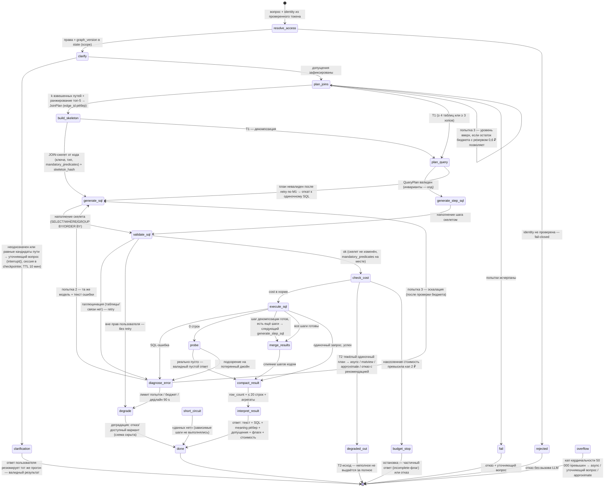

# State Diagram — агент Text-to-SQL (FSM)

- **Статус:** каноническая схема v1.3 (2026-11-18 — состав 15 узлов = hw-01 §2.1: +`build_skeleton`, +`compact_result`, +probe `COUNT`; `generate_step` → `generate_step_sql`; ретраи M1 на рёбрах (D-016); два уровня предохранителей (per-node + `recursion_limit`); T2 → async/matview/approximate/отказ (ADR-004 v1.2); clarify — `interrupt()` + checkpointer, TTL 10 мин. v1.2 — валидация JoinPlan + эскалация plan_joins; v1.1 — ревизия 02)
- **Требования prd.md:** FR-1…FR-14; переходы контролирует код — модель не может перепрыгнуть валидацию или уйти из цикла (ADR-002)
- **Связанные:** ADR-002 (recursion_limit — второй предохранитель), ADR-004 (ветка декомпозиции, T2-исходы), ADR-005 (degrade vs diagnose), ADR-006 (JoinPlan по `edge_id`), ADR-007 (политика ретраев M1), ADR-009 (кэш); c4-l3-agent.md (компоненты узлов), sequence-query.md (интерактивный путь целиком)

## Чтение схемы

- **Состав узлов — 15, идентичен hw-01 §2.1:** `resolve_access`, `clarify`,
  `plan_joins`, `build_skeleton`, `plan_query`, `generate_sql`,
  `generate_step_sql` (переименован из `generate_step`), `validate_sql`,
  `check_cost`, `execute_sql`, `merge_results`, `compact_result`,
  `diagnose_error`, `interpret_result`, `degrade`. Код-probe `COUNT` — ребро
  после `execute_sql` при 0 строк (не отдельный узел); `validate_step` /
  `execute_step` в декомпозиции — те же `validate_sql`/`execute_sql` над шагом.
- **Терминальные исходы (все — валидные `done`-состояния, не ошибки протокола):**
  `clarification` (уточняющий вопрос через `interrupt()`), `done` после
  `interpret_result` (полный ответ), `degrade` (отказ/вариант по правам),
  `short_circuit` («данных нет»), `overflow` (кап кардинальности), `fail` и
  `degraded_out` (уточняющий вопрос / T2-исход), `rejected` (identity),
  `budget_stop` (кап 2 ₽).
- **Clarify — `interrupt()` + checkpointer (TTL 10 мин):** уточняющий вопрос
  приостанавливает граф, сессия живёт в checkpointer (Valkey), ответ пользователя
  резюмирует тот же прогон; TTL истёк — прогон завершается `clarification`-исходом.
- **Контракт `budget_stop` — неполное не выдаётся за полное.** Бюджет-гuard
  проверяется до каждого LLM-вызова; в диаграмме показана плановая точка
  (`check_cost`). При срабатывании: без `interpret_result` над неполными
  агрегатами — флагман «уверенно объяснил бы» неполные цифры как полные (тот же
  класс, что R-Q2). Частичный результат — только с явным `incomplete = true`
  в payload и в ответе (трейс: `query_trace.incomplete`).
- **Кэш** (ADR-009) на схеме не рисуется как состояние: lookup — **после `clarify`,
  до `plan_joins`** (допущения для сверки п. 6 к этому моменту уже зафиксированы).
  Ключ — `rights_hash + graph_version + assumptions`; кэшируется SQL, не результат;
  на хите SQL всё равно проходит `validate_sql` + ACL + `EXPLAIN` — кэш не обходит
  гейт (S7). Hit при совпадении допущений → короткий путь: одиночный SQL →
  `validate_sql`; декомпозированный → цикл шагов минуя `plan_query`/
  `generate_step_sql`. Miss → полный цикл; `put` — оркестратор по факту
  успешного прогона.
- **Два уровня предохранителей (оба — код, ADR-002):** счётчики попыток **на узел**
  (≤ 3, политика M1) и **`recursion_limit` на весь граф** — страховка от комбинаций
  ветвлений, которые наузловые лимиты не покрывают. Плюс глобальные капы на прогон:
  ≤ 8 LLM-вызовов, ≤ 90 s, ≤ 2 ₽. Модель не переопределяет лимиты.
- **Ретраи — политика M1 (D-016, ADR-007 §4.1):** попытка 1 — базовая модель узла;
  попытка 2 — **та же модель + текст ошибки**; попытка 3 — **уровень вверх**,
  только если остатка бюджета хватает (проверка с резервом 0,6 ₽ под
  `interpret_result`). `diagnose_error → generate_sql` несёт эти ветки; назад —
  не откат, а разбор ошибки. Эскалацию назначает код (`retry_count`).
- **Ветка `degrade` vs `diagnose_error` — различение причин** (ADR-005): «таблица не
  существует» — галлюцинация, retry оправдан; «существует, но вне прав» — сигнал
  безопасности, retry не оправдан (модель не должна «уговорить» валидатор) — деградация:
  код фиксирует, чего не хватает, LLM формулирует отказ/вариант бизнес-понятиями,
  без подтверждения существования данных (S9).
- **Ветка декомпозиции** (ADR-004 v1.2): T1 (≥ 4 таблиц / ≥ 3 хопов) — **основной
  путь на боевом масштабе**; каждый шаг проходит ту же валидацию, что и весь SQL
  (AST + ACL + граф + скелет + whitelist key-колонок). Промежуточный key-set —
  полный, без `LIMIT`; кап кардинальности **50 000** ключей: превышение → `overflow`
  (async / отказ / флаг `approximate`); `short-circuit` — честные остановки.
  `LIMIT 1000` — только финальный результат, с флагом усечения.
  **T2 (тяжёлый одиночный план) в декомпозицию не ведёт** — `degraded_out`:
  async / matview / приблизительный расчёт / отказ с рекомендацией.
- **Порядок гарантирует код:** SQL не строится без JoinPlan (`plan_joins`) и
  скелета (`build_skeleton` — джойны пишет код), не выполняется без валидации,
  декомпозиция не включается без порога. Переходов «в обход» не существует — это
  свойство графа, не дисциплины промпта.

---

## Трассировка

Ревизии: v1.3 (15 узлов = hw-01 §2.1, M1, recursion_limit, T2 → degraded_out) · Связанные ADR: ADR-002, ADR-004, ADR-005, ADR-006, ADR-007, ADR-009 · Канон: hw-01/README.md §2, §3.1, §6
