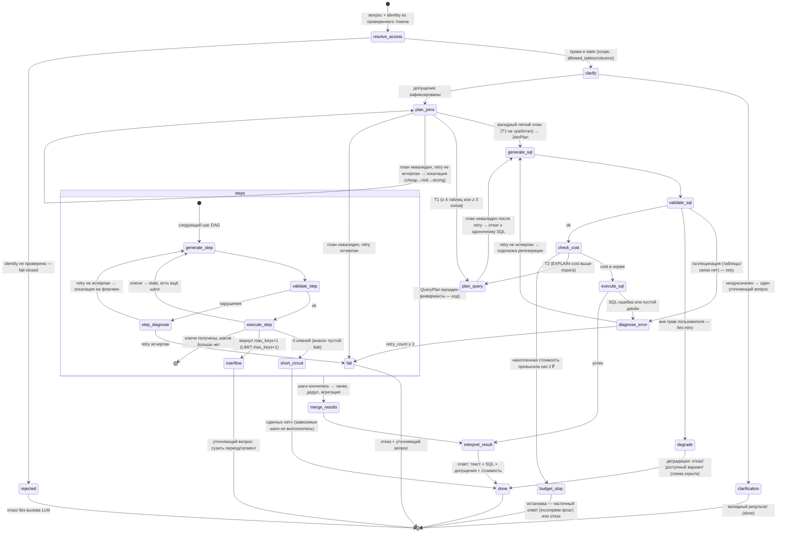

# State Diagram — агент Text-to-SQL (FSM)

- **Статус:** каноническая схема v1.2 (2026-11-16 — валидация JoinPlan + эскалация plan_joins; v1.1 — ревизия 02: позиция кэша, кольцо T2)
- **Требования prd.md:** FR-1…FR-14; переходы контролирует код — модель не может перепрыгнуть валидацию или уйти из цикла (ADR-002)
- **Связанные:** ADR-004 (ветка декомпозиции), ADR-005 (degrade vs diagnose), ADR-007 (эскалация на retry), ADR-009 (кэш); c4-l3-agent.md (компоненты узлов), sequence-query.md (интерактивный путь целиком)

## Чтение схемы

- **Терминальные исходы (все — валидные `done`-состояния, не ошибки протокола):**
  `clarification` (уточняющий вопрос), `done` после `interpret_result` (полный ответ),
  `degrade` (отказ/вариант по правам), `short_circuit` («данных нет»), `overflow` и
  `fail` (уточняющий вопрос), `rejected` (identity), `budget_stop` (кап 2 ₽).
- **Контракт `budget_stop` — неполное не выдаётся за полное.** Бюджет-гuard
  проверяется до каждого LLM-вызова; в диаграмме показана плановая точка
  (`check_cost`). При срабатывании: без `interpret_result` над неполными
  агрегатами — флагман «уверенно объяснил бы» неполные цифры как полные (тот же
  класс, что R-Q2). Вариант честной остановки: пользователю — что успело
  выполниться (SQL шагов, счётчики) + формулировка «остановлено по бюджету»;
  если частичный результат всё же интерпретируется — только с явным
  `incomplete = true` в payload и в ответе (трейс: `query_trace.incomplete`).
- **Кэш** (ADR-009) на схеме не рисуется как состояние: lookup — **после `clarify`,
  до `plan_joins`** (допущения для сверки п. 6 к этому моменту уже зафиксированы;
  ревизия 02 §3.3). Hit при совпадении допущений → короткий путь: одиночный SQL →
  `validate_sql`; декомпозированный → цикл шагов (`validate_step → execute_step`)
  минуя `plan_query`/`generate_step`. Miss (или допущения не совпали) → полный
  цикл. Валидация кэшированного SQL не пропускается; `put` — оркестратор по факту
  успешного прогона (в значении — допущения `clarify`, для декомпозиции ещё
  `query_plan` + `sql_steps`).
- **Лимиты задаются кодом:** retry ≤ 3 — **общий** бюджет (в декомпозиции — на весь
  план, не на шаг: иначе 4 шага × 3 попытки = до 12 генераций; эскалации модели
  расходуют тот же бюджет — ADR-007 v1.1); кап key-set 5000;
  кап 2 ₽. Модель не переопределяет лимиты. Повторное срабатывание T2 на
  откатившемся одиночном SQL расходует общий retry-бюджет; второе T2 → `overflow`
  («сузьте период/сегмент»), а не новый круг декомпозиции (ADR-004 §4; ревизия 02 §3.4).
- **Ветка `degrade` vs `diagnose_error` — различение причин** (ADR-005): «таблица не
  существует» — галлюцинация, retry оправдан; «существует, но вне прав» — сигнал
  безопасности, retry не оправдан (модель не должна «уговорить» валидатор) — деградация:
  код фиксирует, чего не хватает, LLM формулирует отказ/вариант бизнес-понятиями.
- **Ветка декомпозиции** (ADR-004): `plan_query` → цикл `steps` — каждый шаг проходит
  ту же валидацию, что и весь SQL (AST + ACL + граф + whitelist key-колонок);
  `short-circuit` и `overflow` — честные остановки: молча обрезать нельзя.
  Откат к одиночному SQL при невалидном плане после одного retry.
- **Эскалация на retry** (ADR-007 v1.1) — единое правило генерирующих узлов:
  повторная попытка после провала идёт на уровень вверх (cheap→mid→strong).
  `diagnose_error → generate_sql` и `step_diagnose → generate_step` — после провала
  mid сильнее (strong); `plan_joins` — валидация JoinPlan кодом при парсинге
  (таблицы ∈ scope, джойны ∈ рёбрам графа, ≤ 4 таблиц, связность — как инварианты
  `plan_query`, ADR-004): невалидный план → retry с эскалацией cheap→mid→strong,
  исчерпание → `fail` (уточняющий вопрос). Эскалацию назначает код (`retry_count`,
  `route_flags`); назад — не откат, а разбор ошибки.
- **Порядок гарантирует код:** SQL не строится без JoinPlan (`plan_joins`), не
  выполняется без валидации, декомпозиция не включается без порога. Переходов «в
  обход» не существует — это свойство графа, не дисциплины промпта.

---

## Трассировка

Ревизии: v1.2 (v1.2 — валидация JoinPlan + эскалация plan_joins; v1.1 — ревизия 02: кэш, кольцо T2) · Связанные ADR: ADR-002, ADR-004, ADR-005, ADR-007, ADR-009 · Канон: hw-01/README.md §2, §3.1, §6
