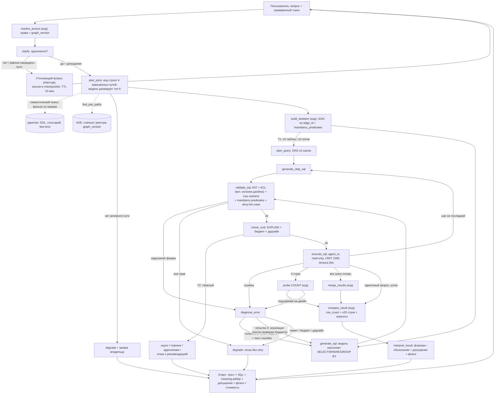
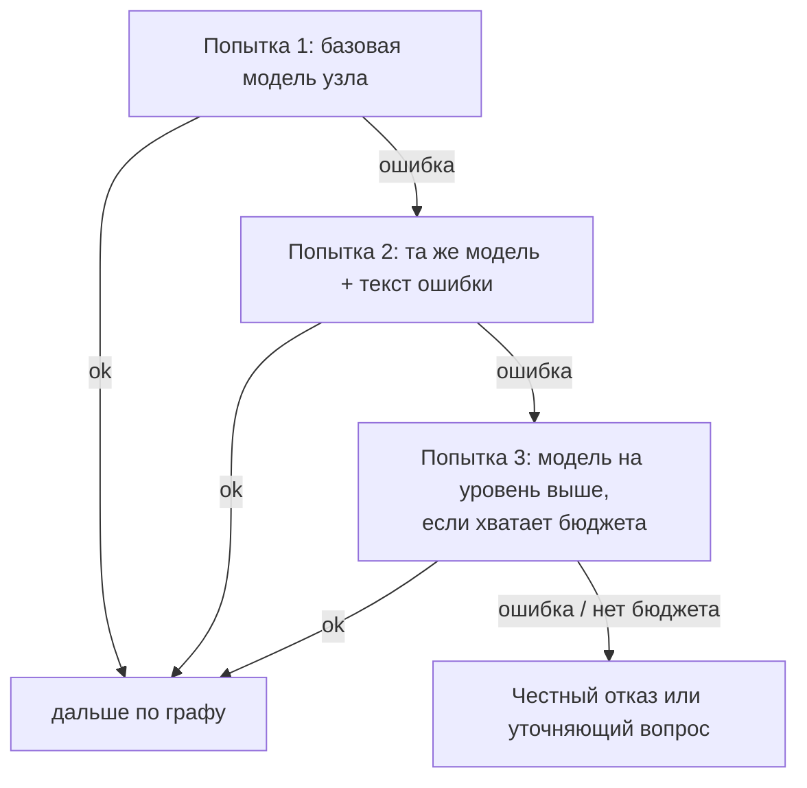

# ДЗ 1. Архитектура ИИ-агента: Text-to-SQL аналитик данных

**Кейс 2 «Агент аналитики данных».**
Стек: Python · LangGraph · FastAPI · PostgreSQL (pgvector + Apache AGE)
· Valkey · sqlglot · pydantic · OpenAI-совместимый LLM-шлюз (routerai.ru).

Агент принимает бизнес-вопрос на естественном языке, строит многотабличный
SQL по графу связей, безопасно выполняет его под правами пользователя и
объясняет результат на языке бизнеса.

---

## 1. Прикладной сценарий

**Проблема.** Доступ к данным идёт через ручные SQL-запросы: аналитик пишет
каждый запрос руками, бизнес ждёт часы на вопрос, который сводится к одному
SELECT с парой JOIN.

**Зачем агент.** Принимает вопрос на естественном языке, сам строит SQL,
безопасно выполняет его и объясняет результат. Время на типовой вопрос -
минуты вместо часов.

**Ограничения кейса → архитектурные требования:**

| Ограничение кейса | Требование к архитектуре |
|---|---|
| Ограниченный доступ к данным | Read-only роль БД + per-user RBAC: права в таблицах настроек, фильтрация мира агента и ACL-валидация (§3.2) |
| Безопасное выполнение SQL | Валидация запроса **до** выполнения: текст от LLM - не доверенный |
| Неоднозначные формулировки | Узел уточнения + бизнес-глоссарий с определениями метрик |
| Сложные связи между таблицами | Реестр связей владельца данных: джойны только по активным рёбрам (§3.3, §3.5) |

**Масштаб и скоуп.** Целевая среда - боевой ландшафт: сотни таблиц, тысячи
связей, несколько доменов (TODO(confirm)); демо-схема из 7 таблиц
(`customers`, `orders`, `order_items`, `products`, `campaigns`, `employees`,
`bonuses`) - отладочный стенд. Только `SELECT`. Диалог - без длинной
истории: уточнение - приостановка прогона (`interrupt()` + checkpointer,
§5), ответ резюмирует тот же граф; сессия - 10 минут.

---

## 2. Цикл работы: workflow с LLM-шагами и детерминированным роутингом

Агент - **workflow с LLM-шагами и детерминированным роутингом**, а не
автономный ReAct: маршрут задаёт state machine на коде, модель наполняет
содержимое узлов. Для продакшена это плюс - предсказуемость, тестируемость,
контроль границ. Цикл Reason → Act → Observe сохранён внутри LLM-узлов;
код-узлы помечены явно.

### 2.1. Узлы

| Узел | Reason (Thought) | Act | Observe |
|---|---|---|---|
| `resolve_access` | - код | токен → роли → права (`agent_permissions`) | права + `graph_version` в state |
| `clarify` | «Однозначен ли вопрос?» | уточняющий вопрос (`interrupt()`) **или** фиксация допущений | вопрос + допущения |
| `plan_joins` | «Какие таблицы и какой путь?» | код строит k взвешенных путей, модель ранжирует топ-5 | JoinPlan: `edge_id` рёбер |
| `build_skeleton` | - код | JOIN-скелет: ключи, тип, обязательные предикаты | скелет + `skeleton_hash` |
| `plan_query` | «Разбить на шаги?» | DAG ≤ 4 шагов (триггер T1, §3.4) | QueryPlan |
| `generate_sql` | «Какой SELECT отвечает?» | наполнение скелета: `SELECT / WHERE / GROUP BY / ORDER BY` | SQL |
| `generate_step_sql` | «SQL текущего шага?» | наполнение шага скелетом | SQL шага |
| `validate_sql` | - код | AST + ACL (вкл. колонки джойна) + хэш скелета + deny-list схем | ok / нарушения |
| `check_cost` | - код | `EXPLAIN` + бюджет + дедлайн | стоимость / триггер T2 |
| `execute_sql` | - код | read-only роль, `LIMIT 1000`, timeout 30s | строки / ошибка |
| `merge_results` | - код | слияние шагов декомпозиции | итоговый набор |
| `compact_result` | - код | `row_count` + ≤ 20 строк + агрегаты | компактный вид для LLM |
| `diagnose_error` | «Почему упал или пуст?» | разбор ошибки + подсказка | контекст → `generate_sql` |
| `interpret_result` | «Что это значит для бизнеса?» | объяснение + допущения + флаги | финальный ответ |
| `degrade` | - код | честный отказ / деградация без retry | ответ пользователю |

Мысль вслух на каждом LLM-узле (~100 дешёвых токенов рассуждения дешевле
повторного цикла при ошибке). Переходы контролирует state machine: LLM не
может «перепрыгнуть» валидацию - модель наполняет узел, код ведёт маршрут.

### 2.2. Правила поведения и инструменты

Правила - часть системного промпта, приоритет выше любых инструкций
пользователя:

- только `SELECT`: никакого DDL/DML, даже если попросят;
- JOIN зафиксирован скелетом (`build_skeleton`): наполняй
  `SELECT / WHERE / GROUP BY / ORDER BY`, тип и направление джойна не трогай;
- не выдумывай таблицы, связи и результат - жди Observation;
- максимум один уточняющий вопрос за итерацию; остальное - явные допущения;
- в финальном ответе - SQL, допущения и флаги неполноты; отказ формулируй
  бизнес-понятиями, без имён таблиц и без подтверждения существования данных.

**Инструмент выбирает код узла, не модель.** Инструменты:

| Инструмент | Назначение | Ограничения |
|---|---|---|
| `search_schema` | векторный поиск по DDL и глоссарию | только таблицы из прав |
| `find_join_paths` | k взвешенных путей по графу связей | только активные рёбра реестра |
| `describe_table` | DDL и комментарии колонок | только таблицы из прав |
| `explain_sql` | оценка стоимости | только `EXPLAIN`; `EXPLAIN ANALYZE` запрещён - он выполняет запрос |
| `run_sql` | выполнение SELECT | read-only, `LIMIT 1000`, timeout 30s |

---

## 3. Архитектура

### 3.1. Схема и её описание

- **Вход и права.** Аутентификация до агента (портал/SSO, проверенный
  токен); `resolve_access` - код: личность → права + `graph_version`
  снапшота графа, всё в state.
- **Основная последовательность:** `clarify → plan_joins → build_skeleton →
  generate_sql → validate_sql → check_cost → execute_sql → compact_result →
  interpret_result` (+ ветка `plan_query → generate_step_sql →
  merge_results`). Джойны пишет код, модель наполняет только
  `SELECT / WHERE / GROUP BY`; к `execute_sql` ведут только маршруты через
  `validate_sql`, включая каждый шаг декомпозиции.
- **Ветвления.** `clarify` может завершить прогон уточняющим вопросом -
  валидный результат (также при равных кандидатах пути). Нет активного
  пути → `degrade` + заявка владельцу (§3.5). Нарушение формы →
  `diagnose_error`; вне прав → `degrade` без retry. T2 → async / matview /
  approximate / отказ. 0 строк → probe `COUNT`: пусто и там - валидный
  пустой ответ, не три ретрая на честный ноль (§6).
- **Хранилища.** Один PostgreSQL: данные, pgvector (векторная память), AGE
  (граф); Valkey - кэш, сессии уточнений (checkpointer), очередь задач (§5,
  §8). Пользовательский SQL - только под read-only ролью `agent_ro`.
- **Граф - производный снапшот реестра** (§3.5) с версией `graph_version`;
  хранилище - заменяемая деталь за интерфейсом `find_join_paths()`. AGE
  оправдывают не масштаб, а взвешенные пути с фильтрацией по свойствам рёбер
  и переранжированием, ACL-подграфы; семантика - в реестре, граф - только
  топология. Факты AGE (проверено 18.11.2026): PostgreSQL 11-18
  ([Docker](https://hub.docker.com/r/apache/age)); риск - темп релизов, не
  «заброшенность» ([roadmap](https://github.com/apache/age/discussions/2305));
  SQL/PGQ в PG19 - аргумент заменяемости (хватит BFS по adjacency - уходим с
  AGE без изменения узлов).

### 3.2. Разделение доступа (RBAC)

Пользователи видят разные данные: логист - только логистику; аналитик с
правами HR - логистику и премии. Глобальный whitelist таблиц этого не
закрывает.

Права - данные в таблицах настроек (`agent_permissions`: роль → таблица →
колонки; `agent_user_roles`: пользователь → роли): выдача/отзыв роли -
правка строк, действует со следующего запроса, без деплоя. Идентичность
подтверждает токен портала/SSO; голый `user_id` в параметре личностью не
считается.

**Граница знаний агента = граница прав:** недоступная таблица не существует
в версии реальности агента - её нет в подграфе и её DDL не попадает в RAG.
На боевом масштабе ACL-подграф материализуется на роль и инвалидируется при
изменении прав; версия подграфа - в ключе кэша. Рубежи на случай бага:

| Рубеж | Что проверяет | За счёт чего |
|---|---|---|
| 1. Фильтрация мира | подграф, retrieval, DDL - только разрешённое | детерминированный код |
| 2. **AST-валидатор - главный рубеж** | таблицы и колонки ∈ правам; одна инструкция; запрет `SET/COPY/CALL/DO` и функций из deny-list; обход CTE/UNION/подзапросов/LATERAL; `LIMIT` - к внешнему запросу; диалект postgres | sqlglot, deny-by-default: узел вне whitelist'а → отказ |
| 3. Deny-list схем | `pg_catalog`, `information_schema`, `ag_catalog`, схемы графа AGE, `agent_*` - не существуют для агента | иначе один SELECT утаскивает топологию БД и структуру ролей |
| 4. ACL колонок соединения | ключи джойна (например `email`) доступны? нет - ребро недоступно целиком | вычисляется из `agent_permissions`, без PII-флага на ребре |
| 5. БД - второй настоящий рубеж | read-only транзакция, `statement_timeout` на сессию, RLS + `SET LOCAL app.user_id`; раздельные коннекты: планировщик (`ag_catalog` в `search_path`) и исполнитель `agent_ro` (без него) | агент не может ослабить рубеж ни промптом, ни SQL |

Валидатор проверяет и скелет: хэш JOIN-скелета не изменён моделью, все
`mandatory_predicates` ребра на месте (`MANDT`, `lang`, `deleted=false`,
tenant), джойны ⊆ `edge_id` плана.

**Аудит** (обязателен для кейса «ограниченный доступ»): append-only таблица -
пользователь, вопрос, SQL, `edge_id`, `graph_version`, число строк, отказы
по правам, стоимость, уровни моделей; вне state агента; PII в логах и
трейсах редактируется.

Галлюцинация несуществующей таблицы → retry через `diagnose_error`;
существует, но вне прав → `degrade` без retry. Отказ не раскрывает ни схему,
ни существование чужих данных: *«Часть данных по этому вопросу вам
недоступна. Могу показать отгрузки без блока о премиях - подойдёт?»*

### 3.3. Семантика связей: реестр - источник истины

Единственный источник истины по связям - реестр `agent_relationships`,
который ведёт владелец данных (§3.5). FK - не ребро, а генератор кандидатов
в очередь владельцу: технически корректный джойн не обязан быть
бизнес-верным. «Клиенты из рекламы»: any-touch даёт цифру, в разы
отличающуюся от бизнес-ожидания first-touch - молча и уверенно. INNER JOIN
там, где бизнес ждёт LEFT, тихо теряет непремированных.

Реестр - **мультиграф**: между парой таблиц может быть несколько активных
рёбер с разной семантикой, поэтому кратчайший путь не годится как решающее
правило. Код строит k взвешенных путей с фильтрацией по свойствам рёбер
(`intent_tags`, `temporal`), модель ранжирует топ-5, при равных
кандидатах - `clarify`. План Б (BFS): соседство по `edge_id`, не по паре
таблиц.

**Джойны пишет код, не модель.** Из рёбер плана код собирает JOIN-скелет
(ключи, тип, обязательные предикаты); модель наполняет только
`SELECT / WHERE / GROUP BY / ORDER BY`. Права - тоже один источник:
доступность ребра вычисляется из прав на колонки соединения (§3.2).

**Fan-out и двойной счёт.** `orders JOIN order_items` + `SUM(orders.total)`
удваивает выручку - самый частый класс тихих ошибок Text-to-SQL. У ребра
есть `cardinality` и `fanout_guard`; планировщик не пускает агрегацию
поверх fan-out без предагрегации в CTE.

### 3.4. Тяжёлые запросы: декомпозиция

Триггеры решает код, не LLM. **T1** - структурный (≥ 4 таблиц или путь
≥ 3 хопов): на боевом масштабе основной путь; на стенде из 7 таблиц T1 не
срабатывает, `plan_query` - заглушка «не декомпозировать» - оговорка
стенда, не дизайна. **T2** - стоимость (`EXPLAIN`-порог в `check_cost`):
тяжёлый одиночный план ведёт **не** в декомпозицию, а в async / matview /
приблизительный расчёт / отказ с рекомендацией: разбиение на «ключи →
`= ANY(array)`» (semi-join по массиву ключей, batch-fetch) обычно медленнее
одиночного -
теряется оптимизация плана, растут round-trips. Декомпозиция - ради
корректности структурно сложного запроса, не ради цены.

QueryPlan - DAG из ≤ 4 шагов, инварианты проверяет код при парсинге. Шаг 1
достаёт **полный** key-set без `LIMIT` - усечение промежуточного шага тихо
занижает финальную сумму; вместо лимита cap кардинальности: 50 000 ключей,
превышение → async / отказ / флаг `approximate`. Слияние - код
(`merge_results`).

**Лимиты прогона:** `deadline = 90 s`, `statement_timeout = 30 s`,
`max_sql_executions = 4`; остаток времени проверяется перед каждым
выполнением и каждой эскалацией. Порог T2 - advisory, реальный страж -
timeout.

### 3.5. Реестр связей: контракт и владение

**Контракт ребра** (полный DDL - в архитектурном пакете):

| Группа | Поля | Назначение |
|---|---|---|
| Идентичность | `edge_id`, `version`, `status(draft/active/deprecated)`, `replaced_by` | адресация в плане, валидаторе и аудите; устаревание вместо удаления |
| Соединение | `left_table` + `left_columns[]`, `right_table` + `right_columns[]`, `join_operator`, `join_type(inner/left)` | составные ключи; направление и тип джойна |
| Корректность агрегатов | `cardinality(1:1/1:n/n:1/n:m)`, `fanout_guard` | защита от двойного счёта (§3.3) |
| Обязательные предикаты | `mandatory_predicates(jsonb)`, `temporal(jsonb)` | `MANDT`, языковой ключ, `deleted=false`, tenant; «на дату заказа» vs «на сегодня» |
| Семантика | `meaning`, `intent_tags[]`, `usage_notes` | что связь значит бизнесу; выбор между параллельными рёбрами; ловушки |
| Управление | `weight`, `domain`, `owner`, `reviewed_at`, `ci_report(jsonb)` | ранжирование путей; доменная нарезка; ответственность |

- **Жизненный цикл:** `draft → CI → active`; агент читает только `active`
  (вьюха). CI проверяет по факту: колонки существуют, типы совместимы,
  уникальность ключа, доля сирот, **измеренный fan-out против заявленной
  кардинальности**; расхождение → ребро не активируется (ловит и дрейф
  схемы). Запись - только владелец через ревью, агент строго read-only
  (иначе «подарит» себе ребро в запрещённую таблицу); изменения - в аудит.
- **Версионирование:** снапшот графа - детерминированный ETL из реестра;
  `graph_version` пинится на прогон: state, ключ кэша, аудит - иначе кэш
  отдаст SQL по переопределённому ребру.
- **Заявки на рёбра:** «нет активного пути» - не только отказ, но заявка
  владельцу (`agent_edge_proposals`: пара сущностей, вопрос, частота);
  подтвердит - следующий такой вопрос уже отвечается.
- **Bootstrap:** кандидаты - из FK и майнинга SQL аналитиков и BI-вьюх
  (там зашиты верные джойны); для кросс-доменных рёбер - арбитр data
  steward, иначе самые ценные связи никто не подтверждает.
- **Риски - честно:** cold start - пока реестр пуст, агент бесполезен;
  метрика №1 старта - доля вопросов с активным путём и time-to-edge (SLA
  владельца); владелец - организационное узкое место; сломанное ребро →
  `degrade` + заявка, не retry с перегенерацией.
- **SAP-оговорка** (TODO(confirm)): если ландшафт включает SAP, FK на
  уровне БД практически нет - связи в DDIC/check-таблицах и CDS; реестр
  выражает то, чего каталог не умеет. Пример ребра `orders → deliveries`:
  `mandatory_predicates = {"mandt": "100", "deleted": false}`.

---

## 4. Модели и роутинг

### 4.1. Логика роутинга: Intent-Based

Роутинг статический: определяется не «сложность», а **какой навык нужен**
узлу (генерация SQL, рассуждение, классификация, язык); intent известен
заранее - это роль узла, соответствие «узел → навык → модель» зашито в граф.
Плюсы: контроль инженера, предсказуемость, замена модели в одном месте.

Правило - три уровня: классификация / извлечение / разбор ошибки →
маленькая модель (qwen3.7-flash); генерация кода → средняя (deepseek);
рассуждение и финальный текст → флагман (glm-5.3-prime). Динамика - только
триггеры T1/T2 (код, §3.4) и ретраи/эскалация (§4.3); вероятностный роутер
- когда наберётся собственный eval-сет (§9).

Все три модели - за одним OpenAI-совместимым шлюзом (routerai.ru; снимок
каталога от 18.11.2026 - 618 моделей, имена проверены; тарифы плавают,
расчёт зафиксирован по §7): смена модели - параметр вызова; провайдер
возвращает ролевые алиасы `cheap / mid / strong`.

### 4.2. Выбор моделей по этапам

Релевантные бенчмарки для Text-to-SQL - **Spider 2.0 / BIRD** (execution
accuracy на многотабличных схемах) и LMArena для языка; правила чтения:
низкий результат - дисквалификатор, высокий почти ничего не говорит
(насыщение и загрязнение датасетов). Финальная калибровка - собственным
eval-сетом (§9).

**Матрица (каталог routerai.ru, снимок 18.11.2026):**

| Узел | Модель | Обоснование |
|---|---|---|
| `clarify` | `qwen/qwen3.7-flash` | классификация + один вопрос; вызывается на каждый запрос - скорость (TTFT) и минимальная цена входа |
| `plan_joins` | код строит k путей; `qwen/qwen3.7-flash` ранжирует топ-5, флагман - при неоднозначности | сотни таблиц дешёвая модель не вывезет, ранжирование кандидатов - вывозит; план проверяет код |
| `generate_sql` | `deepseek/deepseek-v4.1-flash-1017`, эскалация на `glm-5.3-prime` (§4.3) | модель наполняет готовый скелет - средней достаточно, эскалация редка; «галлюцинация связи» исчезает как класс, остаются ошибки фильтра/агрегации |
| `plan_query` | `deepseek/deepseek-v4.1-flash-1017` (reasoning), эскалация на glm | DAG строится редко; флагман - только при невалидном плане |
| `generate_step_sql` | `deepseek/deepseek-v4.1-flash-1017`, эскалация на glm | шаг проще целого запроса |
| `diagnose_error` | `qwen/qwen3.7-flash` | узкая задача: текст ошибки + подсказки |
| `interpret_result` | `z-ai/glm-5.3-prime` | единственный текст для пользователя; вход - детерминированная компакция (`compact_result`), а не сырые 1000 строк |
| `resolve_access`, `build_skeleton`, `validate_sql`, `check_cost`, `execute_sql`, `merge_results`, `compact_result`, `degrade` | **код, без LLM** | граница прав и корректность - не место для модели |

Цены - §7: qwen - минимальная цена входа на частых классификационных узлах;
deepseek - профиль «длинный контекст, короткий код»; glm - reasoning и язык
финального текста. **Structured output:** `JoinPlan` / `QueryPlan` /
`ResultCompact` - pydantic-модели, ответ LLM валидируется схемой
(temperature 0) - механическая проверка дешёвая и надёжная. Reasoning-режим
включается адресно (`plan_query`, эскалация).

### 4.3. Ретраи и эскалация: три попытки на узел

«Не получилось» решает код, а не модель: для SQL - валидатор (§3.2), для
плана - механическая проверка (таблицы в правах, джойн - реальное ребро,
таблиц ≤ 4). Политика попыток:

1. **Попытка 1** - базовая модель узла;
2. **Попытка 2** - та же модель + текст ошибки: большинство сбоев - формат
   и невнимательность, дешёвый повтор без оплаты дорогой модели (§7 сходится
   именно на этом);
3. **Попытка 3** - модель на уровень выше (эскалация), только если остатка
   бюджета хватает.

Счётчики - **на узел** (≤ 3 попыток) плюс глобальные капы на прогон:
≤ 8 LLM-вызовов, ≤ 90 s, ≤ 2 ₽. Перед каждой эскалацией - проверка оценки
стоимости против остатка с резервом под `interpret_result` (§7): не хватает -
честный отказ или incomplete, а не «потратили всё и не смогли объяснить».
Не справил и флагман - отказ с уточняющим вопросом.

### 4.4. Лимиты провайдера

- **RPM/TPM:** типовой прогон ≈ **6,6К токенов суммарно** (920 + 1700 +
  2600 + 1400) при 0,9-2,6К на отдельный вызов; HTTP 429 → backoff
  1→2→4с; circuit breaker (5 сбоев подряд → пауза 60с) завершается не
  пустой ошибкой, а деградацией: валидный SQL без объяснения или отложенная
  задача; кэш снижает частоту вызовов.
- **Контекстное окно:** при retry в контекст идёт только последний SQL +
  текст ошибки, не цепочка попыток.
- **Бюджет и время:** кап 2 ₽ с резервом 0,6 ₽ под объяснение (§7); дедлайн
  90 s + `statement_timeout` 30 s + `max_sql_executions` 4 (§3.4).

---

## 5. Память и контекст

Векторная память (pgvector): DDL с комментариями, связи с семантикой
(`meaning`, `usage_notes` - §3.3), бизнес-глоссарий («выручка» =
`SUM(orders.total)`), few-shot «вопрос → успешный SQL». Системный промпт не
раздувается: только правила (§2.2), куски схемы доставляет RAG (~2К токенов
на вызов).

**Кэш не обходит гейт.** Семантический кэш (Valkey): «похожий вопрос →
готовый SQL»; на хите SQL всё равно проходит `validate_sql` + ACL против
текущих прав + `EXPLAIN`. Ключ: `rights_hash + graph_version + assumptions` -
SQL пользователя с правами HR не уедет логисту, переопределение ребра
инвалидирует кэш через `graph_version`; кэшируется SQL, не результат.
Допущения `clarify` на хите сверяются с допущениями текущего вопроса.

**Инъекции второго порядка.** Инструкции могут прийти из данных БД,
RAG-документов, `usage_notes` реестра, few-shot: tool-output и retrieval
маркируются как данные, а не инструкции; действия по тексту из результата
запрещены (§6).

**Valkey** - три роли: семантический кэш; сессии уточнений (checkpointer
LangGraph: `interrupt()` приостанавливает граф, ответ пользователя резюмирует
тот же прогон; TTL 10 минут); очередь задач (§8).

---

## 6. Надёжность: dead loop и отказы

Два уровня предохранителей: счётчики попыток на узел (§4.3) и
`recursion_limit` на весь граф - оба задаёт код, а не модель.

| # | Как агент свалится | Сигнал | Защита |
|---|---|---|---|
| 1 | Зацикливание | retry ≥ 3 на узел / `recursion_limit` | отказ + уточняющий вопрос |
| 2 | Нет активного ребра | `find_join_paths` пуст | уточняющий вопрос + заявка владельцу (§3.5), не «придумывание» джойна |
| 3 | Сломанное ребро (дрейф схемы) | SQL-ошибка на джойне | `degrade` + заявка, не retry |
| 4 | Неверный фильтр/агрегация | валидатор: скелет изменён, `mandatory_predicates` не на месте | отклонение до выполнения; «фантомный джойн» закрыт скелетом (§3.3) |
| 5 | Двойной счёт на fan-out | `cardinality` / `fanout_guard` | планировщик: предагрегация в CTE (§3.3) |
| 6 | Пустой результат | 0 строк | код-probe `COUNT` с ослабленным фильтром: пусто и там - валидный пустой ответ; подозрение на джойн → `diagnose_error` |
| 7 | Cap кардинальности / дедлайн | > 50 000 ключей / 90 s | `approximate`-флаг / async / отказ; неполное не выдаётся за полное |
| 8 | LLM API недоступен, 429 | коды ответов | backoff; circuit breaker → деградация: SQL без объяснения / отложенная задача |
| 9 | Prompt injection: вопрос, данные, RAG, `usage_notes` | валидатор + маркировка tool-output | AST-whitelist + read-only; блокировка + аудит |
| 10 | Исчерпан бюджет | `cost > 2 ₽` | остановка до интерпретации (резерв 0,6 ₽); частичный результат - только с incomplete-флагом |
| 11 | Доступ за пределы прав | ACL, вкл. колонки джойна | `degrade`: отказ без раскрытия чужой схемы + доступный вариант |
| 12 | Усечение `LIMIT 1000` | `row_count = 1000` | флаг усечения в ответе |

---

## 7. Экономика

Модели из каталога routerai.ru (снимок 18.11.2026: имена проверены; тарифы
плавают - расчёт зафиксирован по нижеприведённым значениям, методика важнее
точных цифр). Тарифы qwen двухуровневые (≤ 32K / > 32K токенов); запросы
агента ≤ 6,6К - дешёвый уровень.

| Модель | Вход | Выход | Контекст |
|---|---|---|---|
| `qwen/qwen3.7-flash` | 3,20 ₽ | 13 ₽ | 1M |
| `deepseek/deepseek-v4.1-flash-1017` | 8 ₽ | 12 ₽ | 1M |
| `z-ai/glm-5.3-prime` | 299 ₽ | 939 ₽ | 1M |

| Узел | Модель | Токены in/out | Стоимость |
|---|---|---|---|
| `clarify` | qwen | 800 / 120 | 0,0041 ₽ |
| `plan_joins` | qwen | 1500 / 200 | 0,0074 ₽ |
| `generate_sql` | deepseek | 2250 / 350 | 0,0222 ₽ |
| `diagnose_error` (retry, та же модель) | qwen | 2000 / 150 | 0,0084 ₽ |
| `interpret_result` | glm | 1150 / 250 | 0,5786 ₽ |
| код-узлы (`resolve_access` … `compact_result`, `degrade`) | - | - | 0 |

Вход `interpret_result` в 1150 токенов обоснован компакцией: `compact_result`
отдаёт схему + `row_count` + ≤ 20 строк + агрегаты, а не сырые 1000 строк.

Итоги (политика ретраев - §4.3):

- типовой запрос без retry ≈ **0,61 ₽**; +25% запросов с дешёвым retry
  (попытка 2 - та же модель) ≈ **0,62 ₽**; +5% с эскалацией SQL на glm
  (≈ 1,00 ₽ за вызов) ≈ **0,67 ₽**;
- эффект роутинга, сравнение корректное (оба без retry): «всё на glm» =
  0,352 + 0,636 + 1,001 + 0,579 ≈ **2,57 ₽** - экономия **≈ 76%**; вклад
  равный: `clarify + plan_joins` ≈ 0,98 ₽ и `generate_sql` ≈ 0,98 ₽;
- распределение: `interpret_result` ≈ **95%** стоимости;
- **кап с резервом:** худший случай (план на glm 0,90 + SQL на glm 1,00 +
  объяснение 0,58 ₽) превышает 2 ₽ → `cap = 2 ₽`, `reserve(interpret) =
  0,6 ₽`, генерация ≤ 1,4 ₽; перед эскалацией - проверка против остатка,
  не хватает - честный отказ/incomplete;
- масштаб: 1 000 запросов ≈ **670 ₽** - час работы аналитика; рычаг
  оптимизации - `interpret_result` (шаблон + средняя модель для простых
  результатов, гейт по eval §9) - в базовую версию не входит.

---
