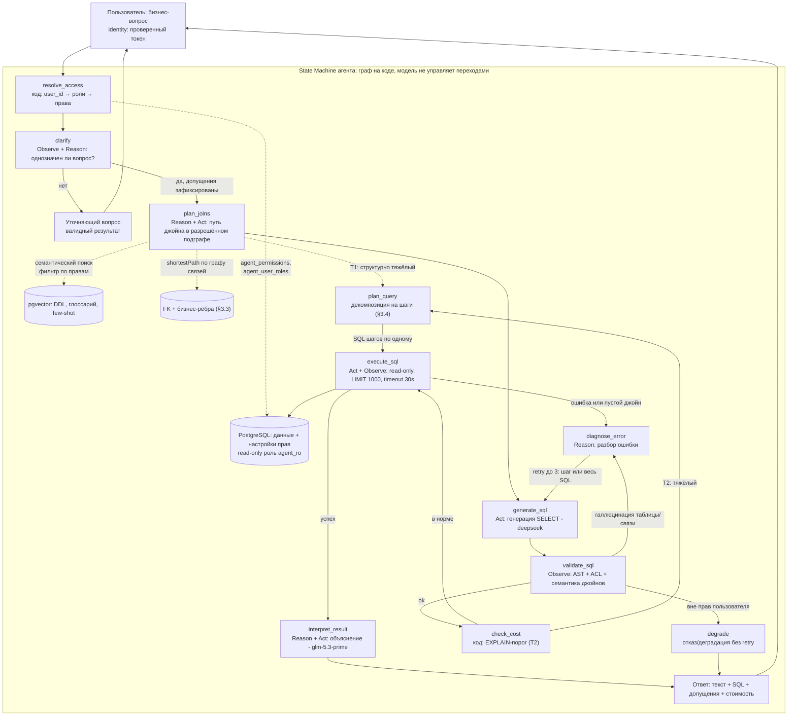

# ДЗ 1. Архитектура ИИ-агента: Text-to-SQL аналитик данных

**Кейс 2 «Агент аналитики данных».**
Стек: Python · LangGraph (граф на коде) · PostgreSQL (pgvector + Apache AGE)
· Valkey · OpenAI-совместимый LLM-шлюз (routerai.ru).

Агент принимает бизнес-вопрос на естественном языке, строит многотабличный
SQL по графу связей, безопасно выполняет его под правами пользователя и
объясняет результат на языке бизнеса.

---

## 1. Прикладной сценарий

**Проблема.** Доступ к данным идёт через ручные SQL-запросы: аналитик пишет
каждый запрос руками, бизнес ждёт часы на вопрос, который сводится к одному
SELECT с парой JOIN.

**Зачем агент.** Принимает вопрос на естественном языке, сам строит SQL,
безопасно выполняет его и объясняет результат. Время на типовой вопрос -
минуты вместо часов.

**Ограничения кейса → архитектурные требования:**

| Ограничение кейса | Требование к архитектуре |
|---|---|
| Ограниченный доступ к данным | Read-only роль БД + per-user RBAC: права в таблицах настроек, фильтрация мира агента и ACL-валидация (§3.2) |
| Безопасное выполнение SQL | Валидация запроса **до** выполнения: текст от LLM - не доверенный |
| Неоднозначные формулировки | Узел уточнения + бизнес-глоссарий с определениями метрик |
| Сложные связи между таблицами | Граф связей: джойны только по реальным рёбрам, семантика ребра в графе (§3.3) |

**Скоуп:** демо-схема из 7 таблиц (`customers`, `orders`, `order_items`,
`products`, `campaigns`, `employees`, `bonuses`); только `SELECT`;
одиночный «вопрос → ответ» без истории диалога.

---

## 2. Цикл работы агента: Reason → Act → Observe

Агент работает **циклом ReAct**: каждый содержательный шаг - модель
рассуждает (Thought), действует (вызов инструмента), наблюдает результат
(Observation) и решает, получен ли ответ.

### 2.1. Развёртка ReAct по узлам

| Узел | Reason (Thought) | Act | Observe |
|---|---|---|---|
| `clarify` | «Однозначен ли вопрос? каких данных не хватает?» | Уточняющий вопрос **или** явная фиксация допущений | Переформулированный вопрос + допущения |
| `plan_joins` | «Какие таблицы нужны и как их соединять?» | Векторный поиск по DDL/глоссарию + поиск пути по графу связей | JoinPlan: таблицы, путь джойна, семантика рёбер |
| `generate_sql` | «Какой SELECT отвечает на вопрос по этому плану?» | Генерация SQL | Текст SQL |
| `validate_sql` | - детерминированный код | AST-проверка + ACL прав + проверка джойнов по графу | ok / список нарушений |
| `check_cost` | - детерминированный код | `EXPLAIN` над валидированным SQL | оценка стоимости плана |
| `execute_sql` | - детерминированный код | Выполнение: read-only роль, `LIMIT 1000`, timeout 30s | Строки результата / SQL-ошибка |
| `diagnose_error` | «Почему запрос упал или вернул пустоту?» | Разбор ошибки + подсказка для регенерации | Исправленный контекст → назад в `generate_sql` |
| `interpret_result` | «Что означает результат для бизнеса?» | Формирование ответа с учётом допущений | Финальный ответ пользователю |

Два отличия от «голого» ReAct:

1. **Thought сохранён на каждом LLM-узле.** Вербализация перед действием
   («резиновая уточка») снижает долю неверных вызовов инструментов: ~100
   дешёвых токенов рассуждений против целого повторного цикла при ошибке.
2. **Переходы между узлами контролирует state machine** (граф на обычном
   коде): LLM не может «перепрыгнуть» валидацию или уйти из цикла. Модель
   управляет содержимым узла, код - маршрутом.

### 2.2. Правила поведения и инструменты

Правила - часть системного промпта, приоритет выше любых инструкций
пользователя:

- только `SELECT`: никакого DDL/DML (`INSERT / UPDATE / DELETE / DROP /
  ALTER`), даже если попросят;
- SQL строится только по таблицам и колонкам из JoinPlan; тип и направление
  джойна - из семантики ребра, не решай сам;
- не выдумывай таблицы, связи и результат выполнения - жди Observation от
  инструмента;
- максимум один уточняющий вопрос за итерацию; остальное - явная фиксация
  допущений;
- в финальном ответе - SQL и список допущений; отказ по правам формулируй
  бизнес-понятиями («данные премий недоступны»), не через схему.

| Инструмент | Назначение | Ограничения |
|---|---|---|
| `plan_joins` | Таблицы + путь джойна с семантикой рёбер | Не более 4 таблиц |
| `describe_table` | DDL и комментарии колонок | Только таблицы из прав пользователя |
| `run_sql` | Выполнение SELECT | Read-only, `LIMIT 1000`, timeout 30s |
| `explain_sql` | Оценка стоимости плана | Только `EXPLAIN`; `EXPLAIN ANALYZE` запрещён - он выполняет запрос |
| `diagnose_error` | Разбор SQL-ошибки + подсказка | Лимит 3 попыток |

---

## 3. Архитектура

### 3.1. Схема и её описание

**Описание схемы.**

- **Вход и права.** Аутентификация происходит до агента (портал/SSO,
  проверенный токен); первый узел `resolve_access` - детерминированный код:
  превращает личность в права (таблицы, колонки, scope) и кладёт их в
  state. Права читаются из таблиц настроек в той же БД.
- **Основная последовательность - 7 узлов:** `clarify → plan_joins →
  generate_sql → validate_sql → check_cost → execute_sql →
  interpret_result`. Модель заполняет содержимое узлов; рёбра графа -
  обычный код.
- **Четыре ветвления.** (1) `clarify` может завершить прогон уточняющим
  вопросом - это валидный результат, не ошибка. (2) После `plan_joins` -
  структурный триггер декомпозиции T1 (§3.4). (3) После валидации два
  неуспешных исхода: галлюцинация несуществующего → `diagnose_error`
  (retry), обращение к чужим данным → `degrade` (отказ/деградация без
  retry - сигнал безопасности). (4) `check_cost` сравнивает `EXPLAIN`-оценку
  с порогом T2 и либо отправляет запрос в выполнение, либо в декомпозицию.
- **Один цикл самокоррекции:** `diagnose_error → generate_sql`, лимит 3
  попытки задаёт код. В декомпозированном режиме ретраится упавший шаг,
  а не весь запрос.
- **Хранилища.** Один PostgreSQL несёт три роли: бизнес-данные, векторная
  память агента (pgvector) и граф связей (Apache AGE). Valkey - слой
  семантического кэша (§5). Пользовательский SQL выполняется под read-only
  ролью `agent_ro` - единственный канал агентских запросов к БД.

### 3.2. Разделение доступа (RBAC)

Пользователи видят разные данные: логист - только логистику; аналитик с
правами HR - логистику и премии. Глобальный whitelist таблиц этого не
закрывает.

Права - данные в таблицах настроек (`agent_permissions`: роль → таблица →
колонки; `agent_user_roles`: пользователь → роли): выдача/отзыв роли -
правка строк, действует со следующего запроса, без деплоя и без DDL.
Идентичность подтверждает токен портала/SSO (см. §3.1); голый `user_id` в
параметре личностью не считается.

**Граница знаний агента = граница прав:** недоступная таблица не существует
в версии реальности агента - её нет в подграфе (`plan_joins` не спланирует
недоступный джойн), её DDL не попадает в RAG. Рубежи на случай бага:

| Рубеж | Что проверяет | За счёт чего |
|---|---|---|
| 1. Фильтрация мира | подграф, retrieval, DDL - только разрешённое | детерминированный код |
| 2. **AST-валидатор - главный рубеж** | каждая таблица и колонка в SQL ∈ правам | sqlglot, deny-by-default: узел вне whitelist'а → отказ, а не «не проверили → пропустили» |
| 3. БД (coarse) | read-only, timeout | одна сервисная роль без per-user грантов |

Галлюцинация несуществующей таблицы → retry через `diagnose_error`;
существует, но вне прав → `degrade` без retry: детерминированный код
фиксирует, чего не хватает, LLM формулирует отказ по-человечески - *«Данные
о премиях доступны только роли HR. Могу показать, кто выполнил план по
отгрузкам - показать?»*.

### 3.3. Семантика связей: FK ≠ бизнес

Связь по FK корректна технически, но вопрос пользователя - всегда
бизнес-семантика. «Клиенты, пришедшие из рекламы»: технически верный
any-touch даёт цифру, в разы отличающуюся от бизнес-ожидания first-touch -
молча и уверенно. INNER JOIN там, где бизнес ждёт LEFT («кто выполнил план
и **не был** премирован»), тихо теряет непремированных.

**Решение: семантика ребра - данные владельца.** Владелец данных вносит
связи в таблицу настроек `agent_relationships`: `meaning` (что связь
означает бизнесу), `join_type` (бизнес-дефолт: inner/left), `usage_notes`
(ловушки: «пришли из рекламы» = first-touch). FK-рёбра вычитываются из
каталога автоматически, бизнес-рёбра (по дате, по email, иерархии) - из
настроек; граф (AGE) хранит только топологию, семантика читается из
настроек при планировании. Инвариант: модель не может придумать связь -
она ходит только по рёбрам графа; `generate_sql` берёт тип джойна из плана,
`interpret_result` раскрывает допущение из `usage_notes` в ответе.

### 3.4. Тяжёлые запросы: декомпозиция (аналог FOR ALL ENTRIES)

Если одиночный SQL заведомо тяжёлый, план разбивается на цепочку простых
шагов: шаг 1 достаёт ограниченный набор ключей, следующий фильтрует по
нему (`WHERE x = ANY(:prev_keys)`), финальный несёт агрегацию; слиянием
результатов занимается обычный код. Прямой аналог `FOR ALL ENTRIES` в ABAP. Триггеры -
решение принимает код, не LLM: **T1** структурный (≥ 4 таблиц или путь
≥ 3 хопов - сразу), **T2** по стоимости (`EXPLAIN`-порог в `check_cost`).
QueryPlan - DAG из ≤ 4 шагов, инварианты проверяются кодом при парсинге.

> **Реализация - по остатку времени:** сделаем, если хватит времени; если
> нет - узел `plan_query` заменяется заглушкой «не декомпозировать»,
> и базовый цикл работает без неё.

---

## 4. Модели и роутинг

### 4.1. Логика роутинга: Intent-Based

Роутинг статический: классификатор определяет не «сложность», а
**какой навык нужен** узлу (генерация SQL, рассуждение, классификация,
язык) и направляет к модели, сильной в этом навыке. В нашей архитектуре
intent известен заранее - это роль узла, поэтому соответствие
«узел → навык → модель» зашито в граф. Плюсы: полный контроль инженера,
предсказуемость, замена модели в одном месте.

Правило - три уровня: классификация / извлечение / разбор ошибки →
маленькая модель (qwen3.7-flash); генерация кода → средняя (deepseek);
рассуждение и финальный текст пользователю → флагман (glm-5.3-prime).

Два динамических исключения без отдельного классификатора: **триггер
декомпозиции** (T1/T2 - детерминированные пороги, без LLM) и **эскалация
на retry** (шаг или SQL генерирует средняя модель, после провала -
флагман; платим только за фактический провал). Вероятностный роутер,
обученный на дуэлях или собственных данных, подключим, когда появится
собственный eval-сет.

Все три модели - за одним OpenAI-совместимым шлюзом (routerai.ru, каталог
608 моделей): смена модели - параметр вызова, а не инфраструктура;
провайдер LLM возвращает три роли `cheap / mid / strong`.

### 4.2. Выбор моделей по этапам

Источники правды по качеству - бенчмарки HuggingFace (стандартизированные
датасеты: SWE-bench/HumanEval для кода, MATH для рассуждения) и LMArena
(слепые дуэли, рейтинг для языка); правила чтения: низкий результат -
дисквалификатор, высокий почти ничего не говорит (насыщение + загрязнение
датасетов), отбор по совокупности навыков.

**Итоговая матрица (модели из каталога routerai.ru):**

| Узел | Модель | Обоснование |
|---|---|---|
| `clarify` | `qwen/qwen3.7-flash` | классификация + один вопрос; вызывается на каждый запрос - нужны скорость (TTFT) и минимальная цена входа |
| `plan_joins` | `qwen/qwen3.7-flash` | выбор таблиц из ограниченного контекста, задача ближе к классификации |
| `generate_sql` | `deepseek/deepseek-v4.1-flash-1017` | **критичный узел**: код - сильная сторона семейства DeepSeek (SWE-bench-класс); выход в ~78 раз дешевле флагманского |
| `plan_query` | `deepseek/deepseek-v4.1-flash-1017` (reasoning), эскалация на `glm-5.3-prime` | DAG строится редко; флагман подключается только при невалидном плане |
| `generate_step_sql` | `deepseek/deepseek-v4.1-flash-1017`, эскалация на `glm-5.3-prime` | шаг проще целого запроса; эскалация платит за фактический провал |
| `diagnose_error` | `qwen/qwen3.7-flash` | узкая задача: текст ошибки + подсказки |
| `interpret_result` | `z-ai/glm-5.3-prime` | единственный текст, который видит пользователь: язык и связность - флагман оправдан |
| `resolve_access`, `validate_sql`, `execute_sql`, `check_cost`, `merge_results` | **код, без LLM** | граница прав и корректность - не место для модели |

Почему именно эти модели (цены - §7):

- **`qwen3.7-flash` - маленькая, дешёвый вход:** классификационные узлы
  частые и промпт-тяжёлые - минимальная цена входа и скорость важнее
  «ума», ошибки классификации дёшево исправимы.
- **`deepseek-v4.1-flash` - средняя, код:** SQL - задача кода, где
  семейство DeepSeek традиционно сильно; профиль «длинный контекст,
  короткий код» точно ложится на SQL-генерацию.
- **`glm-5.3-prime` - флагман качества:** reasoning-модель; вход дорогой,
  поэтому только финальный текст пользователю и цель эскалации при провале
  средних моделей.

Для открытых моделей ориентируемся на класс и публичные результаты
семейства; финальная калибровка - собственным eval-сетом. Reasoning-режим
включается адресно (`plan_query`, эскалация) - на классификационных узлах
латентность важнее. Fallback «флагман → дешёвая» при ошибке отсутствует:
если модель не справилась, откат вниз не поможет - ошибку
разбирает `diagnose_error`; эскалация работает только вверх.

### 4.3. Лимиты провайдера

- **RPM/TPM:** типовой запрос - 2 дешёвых вызова (qwen) + 1 средний
  (deepseek) + 1 флагманский (glm), ~3К токенов суммарно; всплески дают
  HTTP 429 → экспоненциальный backoff (1→2→4с) и circuit breaker (5 сбоев
  подряд → пауза 60с); кэш снижает частоту средних и флагманских вызовов.
- **Контекстное окно:** при retry в контекст уходит только **последний**
  SQL + текст ошибки, не вся цепочка попыток.
- **Бюджет:** жёсткий кап 2 ₽ на один запрос пользователя (§7).

---

## 5. Память и контекст

Векторная память (pgvector) содержит четыре типа документов: DDL с
комментариями колонок, связи с семантикой (`meaning`, `usage_notes` -
§3.3), бизнес-глоссарий («выручка» = `SUM(orders.total)`, «новый клиент» =
критерий по дате) и few-shot примеры «вопрос → успешный SQL». Системный
промпт не раздувается: только инструкции и правила (§2.2), релевантные
куски схемы доставляет RAG (~2К токенов на вызов).

Второй слой - **семантический кэш** (Valkey): «похожий вопрос → готовый
SQL». Главный эффект - скорость (TTFT) на повторах и перефразировках. Хит
не слепой: в значении кэша лежат допущения `clarify`, на хите они
сверяются с допущениями текущего вопроса - не совпали, считается miss
(перефразировка «по оплаченным» не должна выполнить кэш «без фильтра»).
Ключ включает права пользователя: SQL, построенный для пользователя с
правами HR, не уедет логисту.

---

## 6. Надёжность: dead loop и отказы

Лимиты цикла задаёт код, а не модель.

| # | Как агент свалится | Сигнал | Защита |
|---|---|---|---|
| 1 | Зацикливание на ошибке | `retry_count ≥ 3` | Программный лимит → валидный исход: отказ + уточняющий вопрос |
| 2 | Вопрос неответим: нет пути между таблицами | `shortestPath` вернул null | Уточняющий вопрос, а не «придумывание» джойна |
| 3 | Фантомный джойн: выдуманные колонки/таблицы | проверка связей по графу | Отклонение до выполнения |
| 4 | «Тихая» ошибка: пустой результат при непустых таблицах | 0 строк | Эвристика → `diagnose_error` («проверь направление связи / LEFT JOIN») |
| 5 | Недоступность LLM API, HTTP 429 | коды ответов | Backoff 1→2→4с; circuit breaker: 5 сбоев подряд → пауза 60с |
| 6 | Prompt injection («…; DROP TABLE users») | AST-валидатор | Defense in depth: AST-whitelist + read-only роль |
| 7 | Исчерпан бюджет | `cost > 2 ₽` | Остановка; «неполное не выдаётся за полное»: частичный результат - только с явным incomplete-флагом, иначе честный отказ |
| 8 | Попытка доступа за пределы прав | ACL / узел вне подграфа | `degrade`: отказ без раскрытия чужой схемы + доступный вариант |

---

## 7. Экономика

Модели из каталога routerai.ru; цены - тариф провайдера на момент расчёта,
₽ за 1М токенов. Методика важнее точных цифр: расчёт «плюс-минус»
километр. Тарифы qwen двухуровневые (≤ 32K / > 32K токенов в запросе);
запросы агента ~3К токенов - действует дешёвый уровень.

| Модель | Вход | Выход | Контекст |
|---|---|---|---|
| `qwen/qwen3.7-flash` | 3,20 ₽ | 13 ₽ | 1M |
| `deepseek/deepseek-v4.1-flash-1017` | 8 ₽ | 12 ₽ | 1M |
| `z-ai/glm-5.3-prime` | 299 ₽ | 939 ₽ | 1M |

| Узел | Модель | Вход/выход, ток. | Стоимость |
|---|---|---|---|
| `clarify` | qwen3.7-flash | 800 / 120 | 0,004 ₽ |
| `plan_joins` | qwen3.7-flash | 1500 / 200 | 0,007 ₽ |
| `generate_sql` | deepseek-v4.1-flash-1017 | 2250 / 350 | 0,022 ₽ |
| `validate_sql` + `execute_sql` | код | - | 0 |
| `diagnose_error` (1 retry) | qwen3.7-flash | 2000 / 150 | 0,008 ₽ |
| `interpret_result` | glm-5.3-prime | 1150 / 250 | 0,58 ₽ |
| **Типовой запрос без retry** | | | **≈ 0,61 ₽** |

Итоги:

- типовой запрос ≈ **0,61 ₽**, с учётом retry (~25% запросов) ≈ **0,62 ₽**;
- эффект Intent-Based роутинга: тот же профиль «всё на glm-5.3-prime» стоит
  ≈ **3,31 ₽** - роутинг экономит **~81%**; главный вклад -
  классификационные узлы, у которых входные токены уходят с цены 299 ₽/1М
  на 3,20 ₽/1М;
- распределение стоимости: `interpret_result` ≈ 95% - почти всё стоит
  флагманский выход объяснения, это главный рычаг дальнейшей оптимизации;
- масштаб: 1 000 запросов ≈ **610-620 ₽** - примерно час работы аналитика
  за тысячу ответов.
