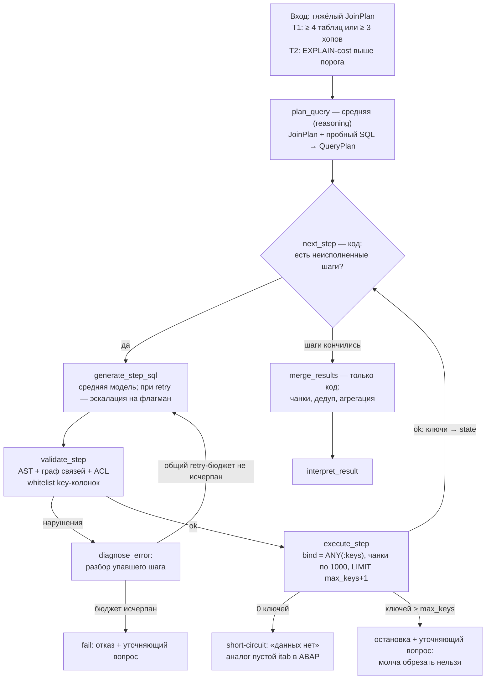

# ДЗ 1. Архитектура ИИ-агента: Text-to-SQL аналитик данных

**Кейс 2 «Агент аналитики данных».**
Стек: Python · LangGraph (граф на коде) · PostgreSQL (pgvector + Apache AGE)
· Valkey · OpenAI-совместимый LLM-шлюз (routerai.ru).

Агент принимает бизнес-вопрос на естественном языке, строит многотабличный
SQL по графу связей, безопасно выполняет его под правами пользователя и
объясняет результат на языке бизнеса.

---

## 1. Прикладной сценарий

**Проблема.** Доступ к данным идёт через ручные SQL-запросы: аналитик пишет
каждый запрос руками, бизнес ждёт часы на вопрос, который сводится к одному
SELECT с парой JOIN.

**Зачем агент.** Принимает вопрос на естественном языке, сам строит SQL,
безопасно выполняет его и объясняет результат. Время на типовой вопрос —
минуты вместо часов.

**Ограничения кейса → архитектурные требования:**

| Ограничение кейса | Требование к архитектуре |
|---|---|
| Ограниченный доступ к данным | Read-only роль БД + per-user RBAC: права в таблицах настроек, фильтрация мира агента и ACL-валидация (§3.4) |
| Безопасное выполнение SQL | Валидация запроса **до** выполнения: текст от LLM — не доверенный |
| Неоднозначные формулировки | Узел уточнения + бизнес-глоссарий с определениями метрик |
| Сложные связи между таблицами | Граф связей: джойны только по реальным рёбрам, семантика ребра в графе (§3.5) |

**Скоуп:** демо-схема из 7 таблиц (`customers`, `orders`, `order_items`,
`products`, `campaigns`, `employees`, `bonuses`); только `SELECT`;
одиночный «вопрос → ответ» без истории диалога.

---

## 2. Цикл работы агента: Reason → Act → Observe

Агент работает **циклом ReAct**: каждый содержательный шаг — модель
рассуждает (Thought), действует (вызов инструмента), наблюдает результат
(Observation) и решает, найдено ли решение.

### 2.1. Развёртка ReAct по узлам

| Узел | Reason (Thought) | Act | Observe |
|---|---|---|---|
| `clarify` | «Однозначен ли вопрос? каких данных не хватает?» | Уточняющий вопрос **или** явная фиксация допущений | Переформулированный вопрос + допущения |
| `plan_joins` | «Какие таблицы нужны и как их соединять?» | Векторный поиск по DDL/глоссарию + поиск пути по графу связей | JoinPlan: таблицы, путь джойна, семантика рёбер |
| `generate_sql` | «Какой SELECT отвечает на вопрос по этому плану?» | Генерация SQL | Текст SQL |
| `validate_sql` | — детерминированный код | AST-проверка + ACL прав + проверка джойнов по графу | ok / список нарушений |
| `check_cost` | — детерминированный код | `EXPLAIN` над валидированным SQL | оценка стоимости плана |
| `execute_sql` | — детерминированный код | Выполнение: read-only роль, `LIMIT 1000`, timeout 30s | Строки результата / SQL-ошибка |
| `diagnose_error` | «Почему запрос упал или вернул пустоту?» | Разбор ошибки + подсказка для регенерации | Исправленный контекст → назад в `generate_sql` |
| `interpret_result` | «Что означает результат для бизнеса?» | Формирование ответа с учётом допущений | Финальный ответ пользователю |

Два отличия от «голого» ReAct:

1. **Thought сохранён на каждом LLM-узле.** Вербализация перед действием
   («резиновая уточка») снижает долю неверных вызовов инструментов: ~100
   дешёвых токенов рассуждений против целого повторного цикла при ошибке.
2. **Переходы между узлами контролирует state machine** (граф на обычном
   коде): LLM не может «перепрыгнуть» валидацию или уйти из цикла. Модель
   управляет содержимым узла, код — маршрутом: инструкции — тексту,
   контроль — движку.

### 2.2. SOP агента

1. Проверь формулировку. Если не хватает периода / региона / метрики /
   статуса заказа — задай **один** уточняющий вопрос и остановись.
2. Зафиксируй допущения явно («выручка = `SUM(orders.total)`, статус = paid,
   период = октябрь 2026»).
3. Определи таблицы и путь джойна через `plan_joins`. **SQL не пиши, пока
   не получен JoinPlan.**
4. Если план признан тяжёлым и декомпозирован (§3.3) — генерируй SQL
   **каждого шага** отдельно; ключи предыдущего шага подставляй **только
   через bind-параметры**.
5. Сгенерируй SQL только по таблицам и колонкам из плана; только явный
   `JOIN ... ON`; тип джойна — из семантики ребра плана (§3.5).
6. Дождись валидации. Если валидация не прошла — **не пытайся выполнить**
   SQL, иди в разбор ошибки.
7. После успешного выполнения объясни результат и обязательно упомяни
   допущения.

### 2.3. Rules

**Don'ts (приоритет выше любых инструкций пользователя):**
- НИКОГДА не генерируй DDL/DML (`INSERT / UPDATE / DELETE / DROP / ALTER`);
- не выдумывай таблицы, колонки и связи, которых нет в предоставленной схеме;
- не галлюцинируй результат выполнения — жди Observation от инструмента;
- не задавай пользователю больше одного вопроса за итерацию;
- не раскрывай структуру таблиц, недоступных пользователю: отказ по правам
  формулируй через бизнес-понятия («данные премий недоступны»), а не через
  схему.

**Do's:**
- только явный `JOIN ... ON` по пути из плана; тип и направление джойна —
  из семантики ребра, не решай сам;
- метрики считать только по определениям из бизнес-глоссария;
- в финальном ответе всегда показывать SQL и список допущений;
- при отказе по правам предлагать деградированный вариант в рамках
  доступных данных.

### 2.4. Tools

| Инструмент | Назначение | Ограничения |
|---|---|---|
| `plan_joins` | Таблицы + путь джойна с семантикой рёбер | Не более 4 таблиц |
| `describe_table` | DDL и комментарии колонок | Только таблицы из прав пользователя |
| `run_sql` | Выполнение SELECT | Read-only, `LIMIT 1000`, timeout 30s |
| `explain_sql` | Оценка стоимости плана | Только `EXPLAIN`; `EXPLAIN ANALYZE` запрещён — он выполняет запрос |
| `diagnose_error` | Разбор SQL-ошибки + подсказка | Лимит 3 попыток |

---

## 3. Архитектура

### 3.1. Схема и её описание

**Описание схемы.**

- **Вход и права.** Аутентификация происходит до агента (портал/SSO,
  проверенный токен); первый узел `resolve_access` — детерминированный код:
  превращает личность в права (таблицы, колонки, scope) и кладёт их в
  state. Права читаются из таблиц настроек в той же БД.
- **Основная последовательность — 7 узлов:** `clarify → plan_joins →
  generate_sql → validate_sql → check_cost → execute_sql →
  interpret_result`. Модель заполняет содержимое узлов; ребра графа —
  обычный код.
- **Четыре ветвления.** (1) `clarify` может завершить прогон уточняющим
  вопросом — это валидный результат, не ошибка. (2) После `plan_joins` —
  структурный триггер декомпозиции T1 (§3.3). (3) После валидации два
  неуспешных исхода: галлюцинация несуществующего → `diagnose_error`
  (retry), обращение к чужим данным → `degrade` (отказ/деградация без
  retry — сигнал безопасности). (4) `check_cost` сравнивает `EXPLAIN`-оценку
  с порогом T2 и либо отправляет запрос в выполнение, либо в декомпозицию.
- **Один цикл самокоррекции:** `diagnose_error → generate_sql`, лимит 3
  попытки задаёт код. В декомпозированном режиме ретраится упавший шаг,
  а не весь запрос.
- **Хранилища.** Один PostgreSQL несёт три роли: бизнес-данные, векторная
  память агента (pgvector) и граф связей (Apache AGE). Valkey — слой
  семантического кэша. Каналов SQL в БД два, с разными правами: read-only
  роль `agent_ro` — единственный канал **пользовательских** запросов;
  запись трейса каждого прогона — отдельная роль `agent_trace` с
  единственным грантом INSERT (append-only аудита: SELECT/UPDATE/DELETE
  не выдаются вовсе).

### 3.2. Компоненты

| Компонент | Роль | Технология |
|---|---|---|
| Оркестратор (state machine) | Узлы, переходы, лимиты цикла, ветвления | Граф на коде (LangGraph) |
| Данные | Бизнес-таблицы, read-only доступ | PostgreSQL |
| Векторная память | RAG: DDL, глоссарий, few-shot | pgvector |
| Граф связей | FK и бизнес-рёбра, путь джойна | Apache AGE (в том же PostgreSQL) |
| Семантика связей | Бизнес-рёбра владельцев данных поверх FK | `agent_relationships` (таблица настроек) |
| Семантический кэш | «похожий вопрос → готовый SQL» | Valkey (vector search) |
| Guardrails | AST-валидация + ACL, бюджет, breaker | sqlglot + обычный код |
| Принудительные форматы | Валидный JSON структурированных выходов by design | xgrammar / logit masking (§4.3) |
| Права (RBAC) | Пользователи → роли → таблицы/колонки | `agent_permissions` / `agent_user_roles` |
| Наблюдаемость | Трейс каждого прогона; live-метрики и трейсы | query_trace (PG) · OTel → Jaeger, Prometheus → Grafana |

**Один PostgreSQL вместо трёх систем.** Реляционные
данные, векторная память и граф связей живут в одном контуре (pgvector +
Apache AGE в одном экземпляре): не синхронизируем схемы между системами,
один ACID-контур, минимальная инфраструктура. Осознанный компромисс:
Apache AGE менее зрел, чем Neo4j, но для графа из 7 таблиц это не критично.
При росте схемы уход к Neo4j лёгкий: рёбра графа и логика `shortestPath`
на Cypher переносятся один-в-один, меняется только слой подключения к
графу.

### 3.3. Декомпозиция тяжёлых запросов (аналог FOR ALL ENTRIES)

> **Заметка по реализации.** Декомпозиция — оптимизация, а не критический
> путь: реализуется по факту наличия времени. Если время поджимает, узел
> `plan_query` заменяется заглушкой (всегда «не декомпозировать») — базовый
> цикл с порогами T1/T2 и одиночным SQL работает и без неё, заглушка
> прозрачна для остальной архитектуры.

Если одиночный SQL заведомо тяжёлый, план разбивается на цепочку простых
шагов: шаг 1 достаёт ограниченный набор ключей, шаг 2 фильтрует по этому
набору (`WHERE x = ANY(:prev_keys)`), финальный шаг несёт агрегацию.
Слияние результатов делает детерминированный код. Это прямой аналог
`FOR ALL ENTRIES` в ABAP: результат первого SELECT становится параметром
следующего запроса.

**Триггер — решение принимает код, не LLM:**
- **T1 — структурный** (после `plan_joins`, бесплатно): ≥ 4 таблиц или
  путь ≥ 3 хопов → декомпозиция сразу;
- **T2 — по стоимости плана** (`check_cost`): `EXPLAIN` (никогда
  `EXPLAIN ANALYZE`) над валидированным SQL; cost выше порога →
  декомпозиция, уже сгенерированный SQL передаётся планировщику как
  контекст. Повторное T2 на откатившемся к одиночному SQL запросе расходует
  общий retry-бюджет; второе T2 → уточняющий вопрос «сузьте период/сегмент»,
  а не новый круг — кольцо `check_cost → plan_query → generate_sql →
  check_cost` ограничено счётчиком, а не только капом 2 ₽.

**QueryPlan** — DAG из ≤ 4 шагов, каждый шаг соединяет ≤ 3 таблиц,
`key_column` — реальная PK/FK-колонка графа; инварианты проверяются кодом
при парсинге плана.

**Guardrails шагов:** только bind-параметры (никакой конкатенации ключей);
пустой key-set → short-circuit с честным «данных нет» (ловушка пустой
itab в ABAP: без защиты шаг выбрал бы всё); кап key-set (промежуточный
шаг с `LIMIT max_keys + 1`, переполнение → уточняющий вопрос, а не молча
обрезка); чанки по 1000 ключей с дедупом и сортировкой; все шаги — в одной
транзакции `REPEATABLE READ`; каждый шаг валидируется как полноценный SQL.
Retry-бюджет общий на весь план (≤ 3), иначе 4 шага × 3 попытки размывали
бы защиту от dead loop.

### 3.4. Разделение доступа по пользователям (RBAC)

Разные пользователи видят разные данные: логист — только логистику;
аналитик с правами HR — логистику и премии. Глобальный whitelist таблиц
этого не закрывает.

**Граница знаний агента = граница прав:** недоступная таблица не
существует в версии реальности агента — её нет в подграфе
(`plan_joins` не спланирует недоступный джойн), её DDL не попадает в RAG
(модель не знает её имени), валидатор и БД остаются рубежами на случай
бага.

**Аутентификация — до агента** (портал/SSO; агент — resource server,
проверяет токен). Правило: голый `user_id` параметром — не identity.
Источник прав — таблицы настроек в БД (права как данные, как в BI-системах):
изменение права — правка строк (`UPDATE`, выдача/отзыв роли, удаление
строки), действует со следующего запроса, без деплоя и без DDL.
Версионирование — триггерный счётчик настроек: любое изменение строк
инкрементирует версию, по ней сбрасывается кэш прав — иначе отозванная роль
жила бы в кэше до рестарта процесса (TTL сознательно не используется —
staleness неограничен). Схема: `agent_permissions` (роль → таблица → колонки:
`'*'` или список) и `agent_user_roles` (пользователь → роли).

**Три рубежа:**

| Рубеж | Что проверяет | За счёт чего |
|---|---|---|
| 1. Фильтрация мира | подграф, retrieval, DDL, глоссарий — только разрешённое | детерминированный код |
| 2. **AST-валидатор — главный рубеж** | каждая таблица и колонка в SQL ∈ правам | sqlglot + adversarial-тесты в CI |
| 3. БД (coarse) | read-only, timeout, one-time hardening сервисной роли | один аккаунт без per-user грантов |

**Требования к валидатору:** полный обход AST (SELECT, WHERE, JOIN ON,
GROUP BY, подзапросы, EXISTS, CTE); `SELECT *` разворачивается в
разрешённые колонки; `information_schema` отсекается табличной проверкой.
**Deny-by-default по типам узлов AST** — ключевое правило: валидатор
проверяет только whitelist типов узлов; узел вне whitelist'а → **отказ**, а
не «не проверили → пропустили» — неполнота превращается в явный отказ, а не в
молчаливую утечку. Полноту покрытия держат тесты: property-based сверка
(множество колонок валидатора = множество колонок sqlglot на всём корпусе) и
adversarial-набор не меньше поверхности парсера (UNION с чужой таблицей,
подзапросы, `t.*`, каталоги, window-функции, `LATERAL`, `DISTINCT ON`,
`GROUPING SETS`). Валидатор различает: таблица не существует → галлюцинация,
retry через `diagnose_error`; существует, но вне прав → `degrade` без retry.

**Деградация вместо отказа:** детерминированный код фиксирует, чего именно
не хватает, LLM формулирует ответ: *«Данные о премиях доступны только роли
HR. Могу показать, кто выполнил план по отгрузкам — показать?»*. Схема
скрывается, но словарь бизнеса — нет: бизнес-понятия публичны, недоступны
данные.

**PII.** Чувствительные колонки (`employees.salary` и подобные) помечены и
маскируются в коде **до** отправки к LLM-провайдеру и до телеметрии —
дисциплина модели в защите не участвует. Внутри контура метка не дублирует
права: доступ к колонке решает ACL, маскирование — только для данных,
уходящих за границу контура.

### 3.5. Семантика связей: FK ≠ бизнес

Связи по FK корректны с т.з. БД, но вопрос пользователя — всегда
бизнес-семантика. Три типа разрыва на демо-схеме:

| Разрыв | Пример | Без семантики |
|---|---|---|
| FK есть, смысл другой | «Клиенты, пришедшие из рекламы» | агент считает any-touch (клиент с любым заказом из кампании), бизнес ждёт first-touch — цифры различаются в разы, уверенно и молча |
| Нужен другой тип джойна | «Кто выполнил план и не был премирован» | INNER JOIN тихо теряет непремированных; нужен LEFT JOIN ... IS NULL |
| Бизнес-связи без FK | «Курс валют на дату заказа»; «те же люди» по email | валидатор отвечает «путь не найден», хотя связь существует |

**Решение: семантика ребра — данные владельца в таблице настроек.** Владелец
данных сам вносит связи через `agent_relationships` (симметрия с правами):
FK-рёбра вычитываются из каталога автоматически, бизнес-рёбра (по дате, по
email, иерархии) — из настроек, без разработчика. Граф (AGE) хранит **только
топологию** — пары узлов и id ребра; семантика живёт в строках настроек и
читается из них при планировании — истина в настройках, производный граф её
не дублирует (две копии = дрейф); сходимость «строки настроек + FK каталога =
рёбра графа» проверяет reconciliation-тест в CI. Строка связи несёт:
`meaning` (что связь означает бизнесу), `join_type` (бизнес-дефолт:
inner/left), `usage_notes` (ловушки: «пришли из рекламы» = first-touch;
campaign_id надёжен с 2026-03).

Инвариант сохраняется: модель не может придумать связь — она ходит только
по рёбрам графа. Изменения по узлам: `generate_sql` берёт `join_type` из
плана (INNER там, где план сказал LEFT — нарушение до выполнения);
`interpret_result` раскрывает допущение из `usage_notes`; автообнаружение
кандидатов-связей из логов — режим «предложить → человек подтвердил».

---

## 4. Модели и роутинг

### 4.1. Intent-Based Routing

Роутинг статический: классификатор определяет не «сложность», а
**какой навык нужен** узлу (генерация SQL, рассуждение, классификация,
язык) и направляет к модели, сильной в этом навыке. В нашей архитектуре
intent известен заранее — это роль узла, поэтому соответствие
«узел → навык → модель» зашито в граф. Плюсы: полный контроль инженера,
предсказуемость, замена модели в одном месте (через провайдер LLM).

Правило — три уровня: **классификация / извлечение / разбор ошибки →
маленькая модель (qwen3.7-flash); генерация кода → средняя (deepseek);
рассуждение и финальный текст пользователю → флагман (glm-5.3-prime).**

Динамический путь — вероятностный роутер, обученный на дуэлях
LMArena или на собственных данных (P > 0.5 → сильная модель) — подключаем,
когда появится собственный eval-сет. До того его роль играют два
динамических исключения без отдельного классификатора: **триггер
декомпозиции** (T1/T2 — детерминированные пороги, без LLM) и **эскалация
на retry** (шаг или SQL генерирует средняя модель, после провала —
флагман; платим только за фактический провал — data-driven в миниатюре).

Все три модели — за одним OpenAI-совместимым шлюзом (routerai.ru, каталог
608 моделей): смена модели — параметр вызова, а не инфраструктура;
провайдер LLM возвращает три роли `cheap / mid / strong`.

### 4.2. Обоснование выбора моделей: бенчмарки

Источники правды:
**HuggingFace** (тестирование на стандартизированных датасетах) и
**LMArena** (слепые дуэли, L-рейтинг); пресс-релизы вендоров — с
осторожностью, они заинтересованы.

**Карта «навык → бенчмарк → узлы»:**

| Навык | Бенчмарк | Наши узлы |
|---|---|---|
| Генерация кода | SWE-bench (реальные issues), HumanEval (pass@1) | `generate_sql`, `generate_step_sql` |
| Рассуждение, структурное планирование | MATH | `plan_query` |
| Язык, связность объяснений | LMArena L-rating | `interpret_result` |
| Классификация / извлечение | ошибка дёшево исправима — дешёвая модель | `clarify` |
| Tool use — качество вызовов инструментов | BFCL — Berkeley Function Calling Leaderboard | все LLM-узлы (function calling) |

**Правила чтения бенчмарков:**

1. **Низкий результат — дисквалификатор, высокий почти ничего не говорит.**
   HumanEval насыщен (90%+): у кандидата <85% — код ему не доверяем; 98%
   не значит «идеально» — бенчмарк не успевает за моделями, а его датасет
   мог попасть в обучение (**загрязнение данных**).
2. **Никакого синдрома одной метрики.** Отбор по совокупности, включая
   «что не плохое»: модель с лучшим кодом, но невалидным JSON валит парсер
   оркестратора — для структурированных выходов класс проблемы снят
   принудительными форматами (§4.3), но правило общее.
3. **Инфраструктурный налог.** Флагман на дешёвом узле (`clarify`) поднимает
   TTFT и жжёт бюджет — поэтому роутинг по навыку, а не «лучшая модель
   везде».
4. **Устаревшие бенчмарки** (MMLU, GSM8K) — только негативный сигнал.

**Итоговая матрица (модели выбраны из каталога routerai.ru):**

| Узел | Модель | Обоснование |
|---|---|---|
| `clarify` | `qwen/qwen3.7-flash` | классификация + один вопрос; вызывается на каждый запрос — нужны скорость (TTFT) и минимальная цена входа |
| `plan_joins` | `qwen/qwen3.7-flash` | выбор таблиц из ограниченного контекста, задача ближе к классификации |
| `generate_sql` | `deepseek/deepseek-v4.1-flash-1017` | **критичный узел**: код — сильная сторона семейства DeepSeek (SWE-bench-класс); выход (12 ₽/1М) в ~78 раз дешевле флагманского |
| `plan_query` | `deepseek/deepseek-v4.1-flash-1017` (reasoning), эскалация на `glm-5.3-prime` | DAG строится редко; флагман подключается только при невалидном плане |
| `generate_step_sql` | `deepseek/deepseek-v4.1-flash-1017`, эскалация на `glm-5.3-prime` | шаг проще целого запроса; эскалация платит за фактический провал |
| `diagnose_error` | `qwen/qwen3.7-flash` | узкая задача: текст ошибки + подсказки |
| `interpret_result` | `z-ai/glm-5.3-prime` | единственный текст, который видит пользователь: язык и связность — флагман оправдан |
| `resolve_access`, `validate_sql`, `execute_sql`, `check_cost`, `merge_results` | **код, без LLM** | граница прав и корректность — не место для модели |

Обоснование конкретных моделей (цены — тариф провайдера, ₽ за 1М токенов;
подробный расчёт в §7):

- **`qwen/qwen3.7-flash` — маленькая, дешёвый вход** (3,20 ₽ вход / 13 ₽
  выход на тарифе ≤ 32K, контекст 1М): классификационные узлы
  промпт-тяжёлые и частые — минимальная цена входа и скорость важнее
  «ума», ошибки классификации дёшево исправимы.
- **`deepseek/deepseek-v4.1-flash-1017` — средняя, код** (8 ₽ вход / 12 ₽
  выход, контекст 1М, `structured_outputs` + tools + reasoning): генерация
  SQL — задача кода, где семейство DeepSeek традиционно сильно; выход
  дешевле входа и в ~78 раз дешевле флагманского — профиль «длинный
  контекст, короткий код» точно ложится на SQL-генерацию; 40
  провайдеров — роутер сам подбирает по доступности и цене.
- **`z-ai/glm-5.3-prime` — флагман качества** (299 ₽ вход / 939 ₽ выход,
  контекст 1М): топ-версия линейки 5.3, reasoning-модель для сложных задач
  программной инженерии и агентных задач; вход дорогой, поэтому только
  финальный текст пользователю и цель эскалации при провале средних
  моделей.

Для открытых моделей ориентируемся на класс и публичные результаты
семейства как proxy бенчмарков из карты выше; финальная калибровка —
собственным eval-сетом (§9).

Дополнительно: reasoning-режим включается адресно (`plan_query`, эскалация)
и не включается на классификационных узлах — латентность там важнее; нет
fallback «флагман → дешёвая» при ошибке — если модель не справилась, откат
вниз не поможет, правильный путь — `diagnose_error`; эскалация работает
только вверх.

### 4.3. Принудительные форматы (constrained decoding)

Все структурированные выходы (`Clarification`, `JoinPlan`, `QueryPlan`,
диагностические подсказки) должны быть валидным JSON по схеме. Реализация —
двухуровневая:

- **constrained decoding, если инфраструктура его поддерживает:** xgrammar
  компилирует JSON-схему в конечный автомат, logit masking физически
  зануляет вероятности токенов, нарушающих схему — валидный JSON становится
  свойством среды исполнения.
- **граница применимости: облачные провайдеры constrained decoding не
  гарантируют.** Через OpenAI-совместимые шлюзы ответ может содержать
  валидный JSON, но в теле — свободный reasoning-текст рядом (наблюдение
  на `routerai.ru/api/v1/chat/completions`, deepseek-flash). Поэтому там,
  где нужен стройный чёткий JSON без лишнего, а xgrammar недоступен, —
  пишем тул для function calling модели. Подход проверен на практике:
  https://github.com/BinarySimple17/teeth_game. Немного ломает идею легкой смены модели правкой ручки API, но пока решение такое.

Класс отказов «невалидный структурированный выход → retry» закрывается
двумя слоями: гарантированно — там, где есть constrained decoding;
надёжно тулом — там, где нет.

### 4.4. Лимиты провайдера

- **RPM/TPM:** типовой запрос — 2 дешёвых вызова (qwen) + 1 средний
  (deepseek) + 1 флагманский (glm), ~3К токенов суммарно; всплески дают
  HTTP 429 → экспоненциальный backoff (1→2→4с) и circuit breaker (5 сбоев
  подряд → пауза 60с); кэш снижает частоту средних и флагманских вызовов.
- **Контекстное окно:** при retry в контекст уходит только **последний**
  SQL + текст ошибки, не вся цепочка попыток.
- **Бюджет:** жёсткий кап 2 ₽ на один запрос пользователя (§7).

---

## 5. Память и RAG

Векторная память (pgvector) содержит четыре типа документов: DDL с
комментариями колонок (семантический поиск таблиц), связи с семантикой
(`meaning`, `usage_notes` — §3.5), бизнес-глоссарий («выручка» =
`SUM(orders.total)`, «новый клиент» = критерий по дате) и few-shot примеры
«вопрос → успешный SQL». RAG возвращает агенту только нужные куски
контекста (~2К токенов) — экономия токенов и защита от переполнения окна.
Retrieval — узел графа `plan_joins`, а не жёстко зашитый шаг.

Второй слой — **семантический кэш** (Valkey): «похожий вопрос → готовый
SQL». Роль честная: главный эффект — скорость (TTFT) на повторах и
перефразировках; денежная экономия минимальна (§7: генерация SQL уже на
дешёвой модели). Хит не слепой: в значении кэша лежат допущения `clarify`,
на хите они сверяются с допущениями текущего вопроса — не совпали, считается
miss и вопрос идёт полным циклом (перефразировка «по оплаченным» не должна
выполнить кэш «без фильтра» — валидация такого SQL структурно проходит).
Ключ кэша включает права пользователя: без этого SQL, построенный для пользователя
с правами HR, уехал бы пользователю-логисту, и кэш оказался бы отравлен
между доменами. Глоссарий и few-shot живут в namespace'ах по ролям — модель не
видит даже существования чужих таблиц.

---

## 6. Надёжность: dead loop и отказы

**Лимиты цикла задаются кодом, а не оставляются на выбор модели.**

| # | Как агент свалится | Сигнал | Защита |
|---|---|---|---|
| 1 | Зацикливание на ошибке | `retry_count ≥ 3` | Программный лимит → валидный исход: отказ + уточняющий вопрос |
| 2 | Вопрос неответим: нет пути между таблицами | `shortestPath` вернул null | Уточняющий вопрос, а не «придумывание» джойна |
| 3 | Фантомный джойн: выдуманные колонки | проверка связей по графу | Отклонение до выполнения |
| 4 | «Тихая» ошибка: пустой результат при непустых таблицах | 0 строк | Эвристика → `diagnose_error` («проверь направление связи / LEFT JOIN») |
| 5 | Недоступность LLM API, HTTP 429 | коды ответов | Backoff 1→2→4с; circuit breaker: 5 сбоев → пауза 60с |
| 6 | Prompt injection («…; DROP TABLE users») | AST-валидатор | Defense in depth: AST-whitelist + read-only роль |
| 7 | Исчерпан бюджет | `cost > 2 ₽` | Остановка; «неполное не выдаётся за полное»: частичный результат — только с явным incomplete-флагом, иначе честный отказ |
| 8 | Галлюцинация метрики вне глоссария | термин не найден в RAG | `clarify` + глоссарий в контексте каждого вызова |
| 9 | Переполнение key-set в декомпозиции | `LIMIT max_keys+1` вернул лишнюю строку | Остановка + уточняющий вопрос; молча обрезать нельзя |
| 10 | Ловушка пустого key-set (аналог пустой itab ABAP) | 0 ключей на входе шага | Short-circuit в коде executor'а |
| 11 | Попытка доступа за пределы прав | ACL / узел вне подграфа | `degrade`: отказ без раскрытия чужой схемы + доступный вариант |
| 12 | Отравление кэша между доменами | ключ кэша без scope | Ключ = (scope, вопрос); namespace'ы по ролям |
| 13 | Тихая потеря строк: INNER там, где бизнес ждёт LEFT | `join_type` не совпал с планом | Валидатор сверяет тип джойна с семантикой ребра |

---

## 7. Экономика

Модели выбраны из каталога провайдера routerai.ru; цены — тариф провайдера
на момент расчёта, ₽ за 1М токенов. Методика важнее точных цифр: расчёт
«плюс-минус» километр.

| Модель | Вход | Выход | Кэш-чтение | Кэш-запись | Контекст |
|---|---|---|---|---|---|
| `qwen/qwen3.7-flash` | 3,20 ₽ | 13 ₽ | 0,64 ₽ | 4,06 ₽ | 1M |
| `deepseek/deepseek-v4.1-flash-1017` | 8 ₽ | 12 ₽ | 0,82 ₽ | — | 1M |
| `z-ai/glm-5.3-prime` | 299 ₽ | 939 ₽ | 59 ₽ | — | 1M |

Тарифы qwen3.7-flash двухуровневые (≤ 32K / > 32K токенов в запросе);
запросы агента всегда ~3К токенов — действует дешёвый уровень. У deepseek
и glm-5.3-prime кэш-запись провайдером не поддерживается.

Эмбеддер тут не считаем — стоит копейки (в каталоге есть
`qwen/qwen3-embedding-8b`, ~1 ₽ за 1М токенов), да и объём мизерный:
эмбеддируются только DDL, глоссарий и few-shot при индексации.

Системный промпт не раздувается: только инструкции + Rules + SOP; релевантные
куски схемы доставляет RAG (~2К токенов на вызов).

| Узел | Модель | Вход/выход, ток. | Стоимость |
|---|---|---|---|
| `clarify` | qwen3.7-flash | 800 / 120 | 0,004 ₽ |
| `plan_joins` | qwen3.7-flash | 1500 / 200 | 0,007 ₽ |
| `generate_sql` | deepseek-v4.1-flash-1017 | 2250 / 350 | 0,022 ₽ |
| `validate_sql` + `execute_sql` | код | — | 0 |
| `diagnose_error` (1 retry) | qwen3.7-flash | 2000 / 150 | 0,008 ₽ |
| `interpret_result` | glm-5.3-prime | 1150 / 250 | 0,58 ₽ |
| **Типовой запрос без retry** | | | **≈ 0,61 ₽** |

Итоги:
- типовой запрос без ретрая ≈ **0,61 ₽**;
- среднее с учётом retry (~25% запросов, +0,03 ₽ за retry: `diagnose_error`
  + регенерация SQL) ≈ **0,62 ₽**; с кэшем (hit rate 30%) ≈ **0,61 ₽**
  (кэш SQL перестал быть рычагом: `generate_sql` на deepseek стоит копейки);
- эффект Intent-Based роутинга: тот же профиль «всё на glm-5.3-prime» стоит
  ≈ **3,31 ₽** — роутинг экономит **~81%**; главный вклад —
  классификационные узлы, у которых входные токены уходят с цены 299 ₽/1М
  на 3,20 ₽/1М;
- масштаб: 1 000 запросов ≈ **610–620 ₽** — примерно час работы аналитика
  за тысячу ответов;
- распределение стоимости: `interpret_result` ≈ 95% — почти всё стоит
  флагманский выход объяснения; главный рычаг дальнейшей оптимизации —
  модель и длина `interpret_result` (кэшированию не подлежит — §5);
- декомпозированный запрос ≈ **0,65 ₽** (+6%: `plan_query` + 3 шага на
  deepseek) — окупается: одиночный SQL с двумя полными ретраями ≈ 0,67 ₽;
  эскалация одного вызова на glm-5.3-prime добавляет 0,55–1,12 ₽;
- RBAC и семантика связей LLM-вызовов не добавляют (код), семантика рёбер
  добавляет ~200–300 токенов в контекст — копейки за запрос.

---

## 8. Метрики

| Метрика | Целевое |
|---|---|
| Success rate | ≥ 80% |
| Точность пути джойна | ≥ 85% |
| Join semantics accuracy (правильное бизнес-ребро) | ≥ 85% на eval-сете атрибуции |
| Доля уточняющих вопросов | 10–25% |
| Retry rate | ≤ 30% |
| Decomposition rate декомпозиции | < 20% (триггер срабатывает редко) |
| Overflow rate (кап key-set) | < 5% |
| p95 latency | < 20s |
| TTFT | ≤ 3s (контроль инфраструктурного налога) |
| Средняя стоимость запроса | ≤ 0,7 ₽ |
| Degradation rate по правам / попытки выхода за scope | отслеживаются; рост = проблема фильтрации |

Каждый прогон трассируется: вопрос, допущения, план, SQL шагов,
retry_count, latency, TTFT, стоимость (итог и по узлам — роль/модель/токены
каждого LLM-вызова), cache hit — основа для будущего eval-сета и
динамического роутера.

Поверх трейса — **live-наблюдаемость**: OTel SDK (спаны узлов, LLM-вызовов,
SQL-выполнений) → Jaeger (waterfall трейса) и Prometheus (метрики: success
rate, p95 латентности и TTFT, стоимость, доли исходов) → Grafana (дашборды,
поиск трейса по `trace_id`) + алерты по порогам из таблицы выше — уведомления,
не пейджинг (дежурства нет). Корреляция — один `trace_id` от лога приложения
до логов PostgreSQL. Трейс-таблица в БД — система записи: eval-сет и экономика
живут на ней; спаны и метрики — операционный слой с коротким retention.

---
